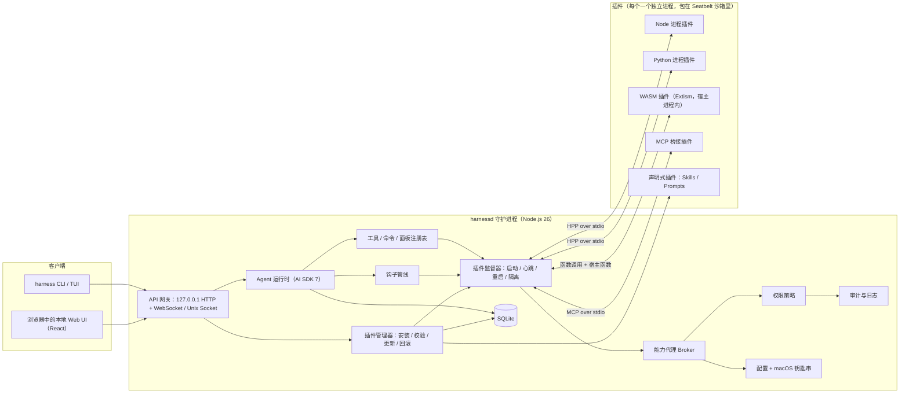
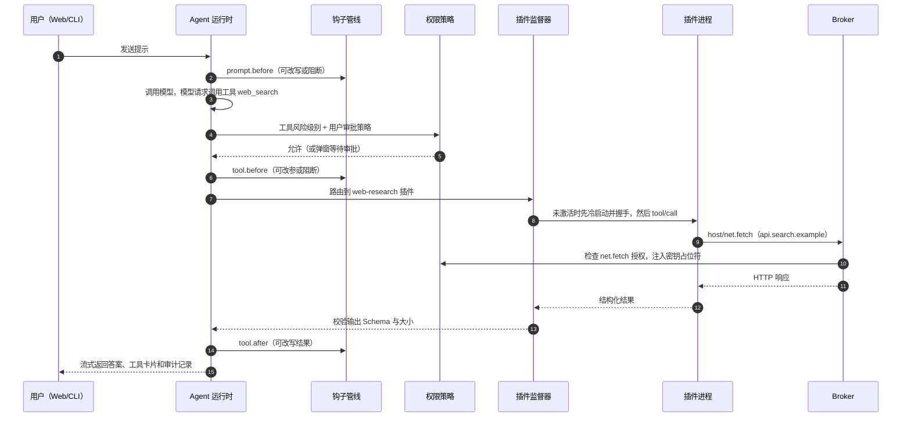
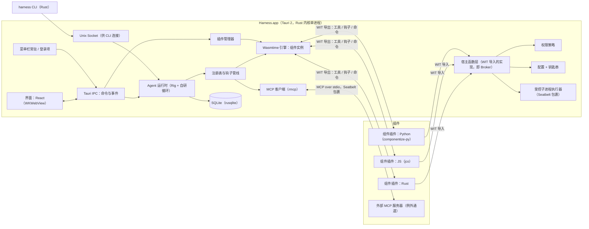
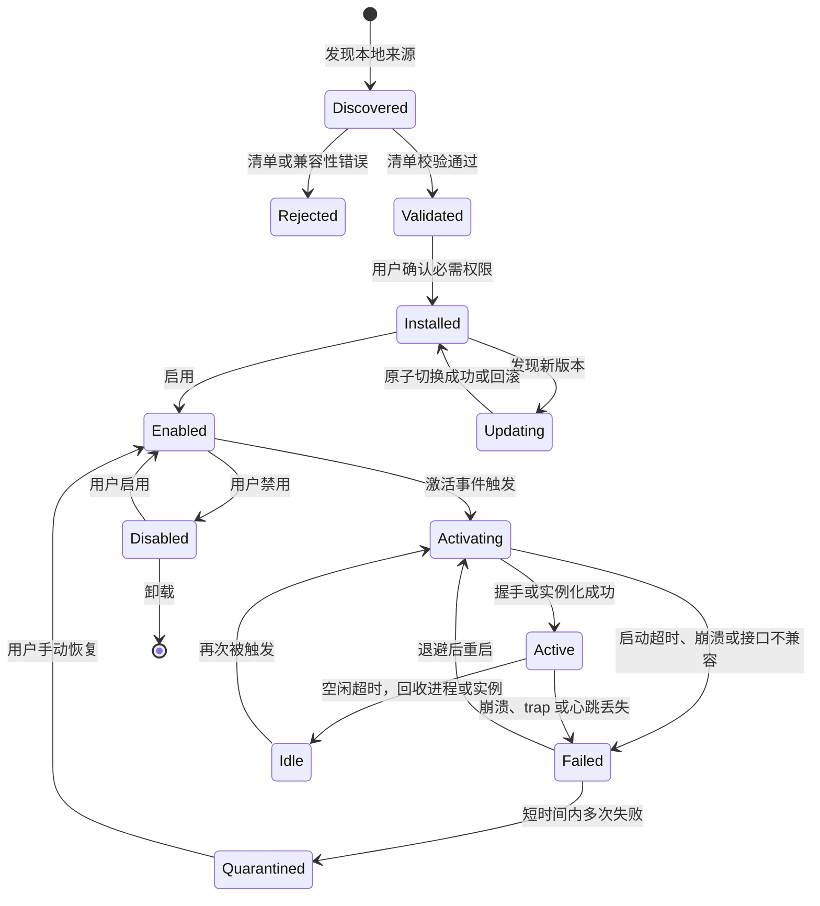
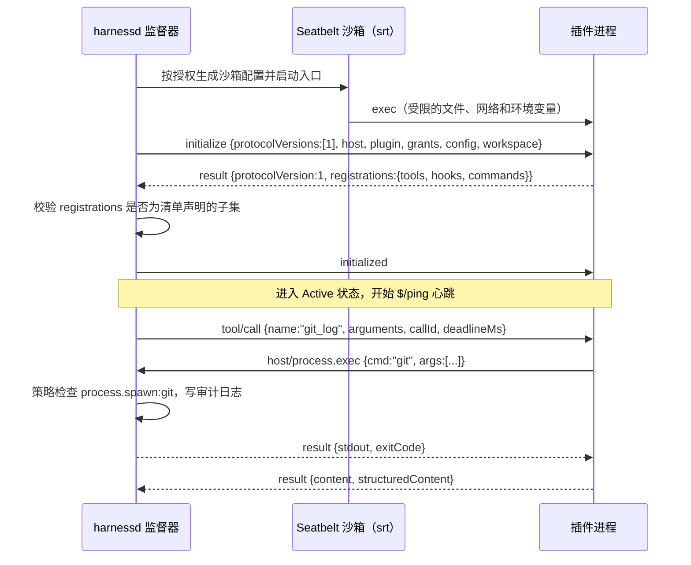
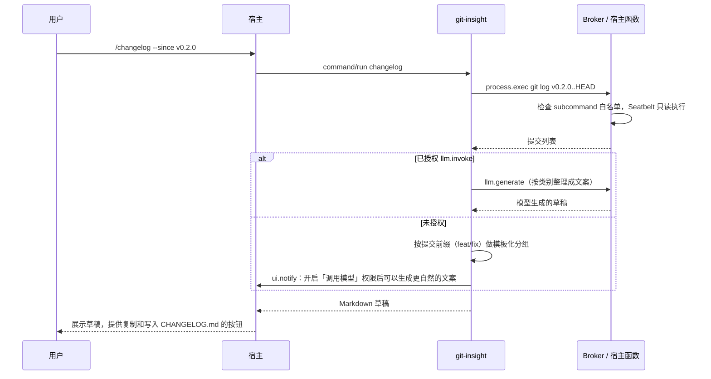
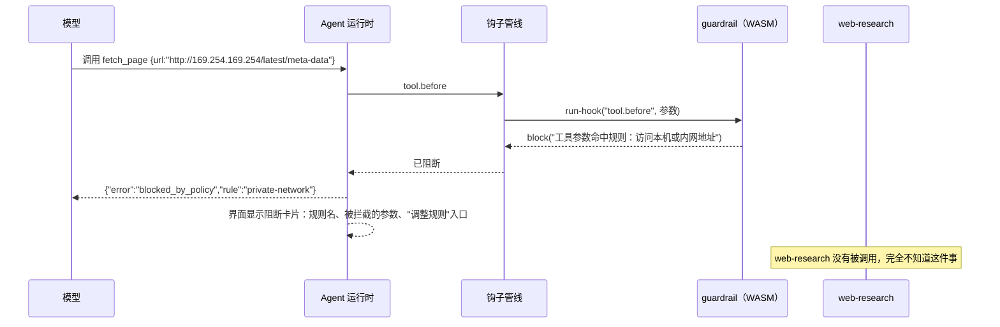
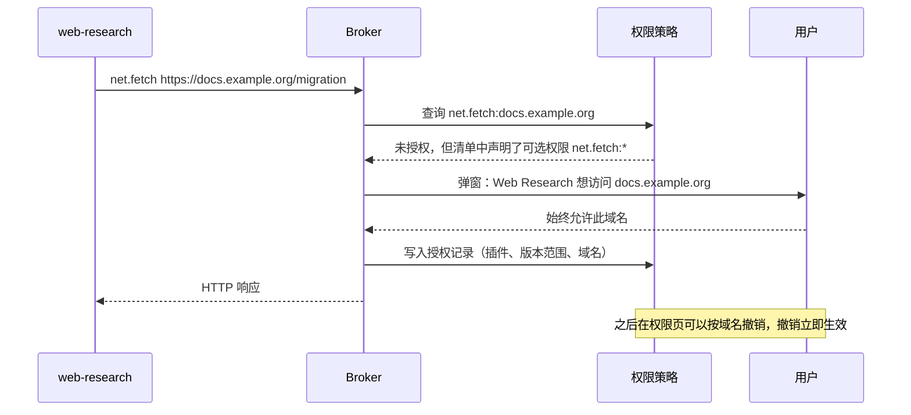
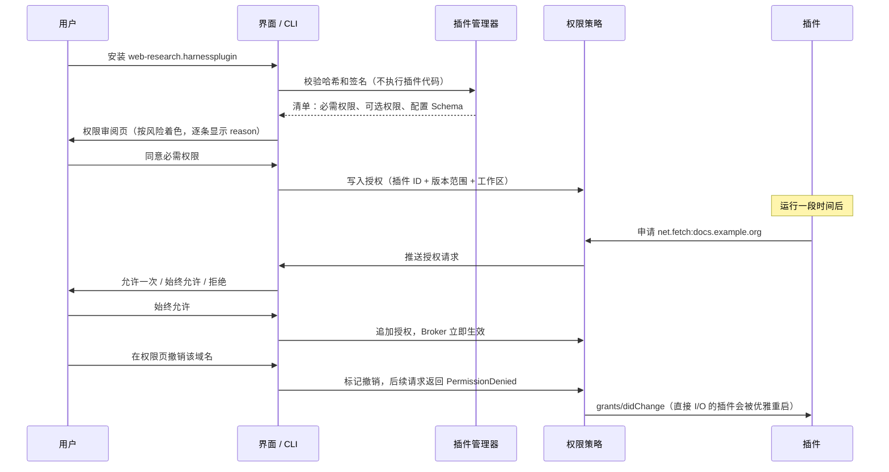

# 插件化本地 AI Agent Harness：技术选型与初步设计报告（macOS 本地版）

> 设计参考：本文包含尚未实现的候选方案；当前运行方式与验证状态以 README.md 为准。

> 版本 v0.2 ｜ 2026-10-24 ｜ 作者：Yuki Li
> 适用范围：**仅 macOS**（macOS 14 Sonoma 及以上，优先 Apple 芯片）、**仅在本机运行**、**单个本地用户**、**不提供远程访问**
> 工作代号：**Harness**（插件协议 **HPP**，即 Harness Plugin Protocol）

本报告给出两套有实质差别的整体方案，覆盖 21 个关键技术节点，每个节点列出至少三个候选方案、评分和推荐结论。在此基础上给出插件协议、权限模型、稳定性机制、本地管理体验和实施路线的初步设计，并单独用一章给出**至少两个有实质差别的示例插件**的完整设计，用来证明插件机制确实能扩展宿主，而不是把功能写死在主程序里。报告可以直接用来拆分开发任务。

## v0.2 修订说明

| 修订项 | v0.1 | v0.2 |
| --- | --- | --- |
| 目标平台 | macOS、Linux、Windows | **仅 macOS**。删除 Linux 和 Windows 的沙箱与降级策略，沙箱改为针对 macOS Seatbelt 的专项设计，并补充 TCC（隐私授权）的处理 |
| 部署与访问 | 本地守护进程，预留多客户端和远程扩展 | **仅本机、单用户**。不做远程访问、多用户和管理员策略；本地服务只需要防范本机浏览器里的恶意网页 |
| 插件来源 | npm、插件索引、来源证明 | **只用本地来源**：本地目录、本地插件包文件、本地 Git 仓库、本地插件目录（Catalog）。公开市场不在本期范围 |
| 整体方案 | 只有一个推荐组合 | **两套有实质差别的完整方案**：方案 A（守护进程 + 进程插件）和方案 B（原生应用 + WebAssembly 组件插件），附对比和选择建议 |
| 示例插件 | 第 8 节一张表 | **独立成第 5 章**：先定义怎样算"有实质差别"，再完整设计三个插件，其中两个是最小必交付 |
| 新增节点 | — | 3.11 后台进程托管（launchd 等）；3.8 改为 macOS 专项的沙箱选型 |

## 结论速览：两套方案

两套方案共用同一套产品设计，包括清单格式、扩展点、权限模型、管理界面、示例插件的功能规格和验收脚本。它们的区别在于**插件代码以什么形态运行，靠什么保证隔离**，这个差别会一直影响到宿主语言、产品形态、插件开发方式和安全保证。

| 维度 | 方案 A：守护进程 + 进程插件 | 方案 B：原生应用 + WebAssembly 组件插件 |
| --- | --- | --- |
| 一句话概括 | 插件是独立的操作系统进程，用任何语言都能写，由能力代理（Broker）、Node 权限模型和 macOS Seatbelt 三层约束 | 插件是 WebAssembly 组件，运行在宿主内的 Wasmtime 沙箱里，本身没有任何 I/O 能力，所有能力都由宿主按授权注入 |
| 产品形态 | `harnessd` 守护进程 + `harness` CLI + 浏览器中的本地 Web UI，后期可以套 Tauri 外壳 | Tauri 2 原生 macOS 应用（带菜单栏常驻）+ `harness` CLI |
| 宿主语言 | TypeScript，Node.js 26 LTS | Rust（tokio 异步运行时） |
| 插件运行形态 | 每个插件一个子进程（Node、Python 或任意语言），另有可选的 WASM 通道 | 每个插件一个 Wasmtime 组件实例（Rust、JS、Python、Go 都可编译成组件），插件不能自己启动子进程 |
| 宿主与插件之间的接口 | HPP：JSON-RPC 2.0 over stdio | WIT 接口 `harness:plugin@1.0.0`（WebAssembly 组件模型，强类型） |
| 隔离靠什么 | 进程边界 + Seatbelt 沙箱（sandbox-exec）+ 网络代理白名单 | 能力模型：没有预开放目录就碰不到文件，没有地址许可就连不上网络；加上内存和执行时间的硬上限 |
| Agent 运行时 | Vercel AI SDK 7 | Rig（Rust）+ 自研 Agent 循环 |
| 主要优点 | 开发最快；插件作者门槛最低；能直接复用 npm、pip 生态和现有 MCP 服务器 | 隔离最强，插件代码不依赖已被 Apple 标记弃用的 sandbox-exec；单进程，资源占用小；原生 Mac 应用体验 |
| 主要代价 | 依赖 sandbox-exec；每个插件占一个进程；多层防御实现起来复杂 | 插件开发门槛高；多语言 WASM 工具链还没完全成熟；团队需要会 Rust；Rust 的 AI 生态较小 |
| 适用场景 | **首选**：想在本机快速验证插件机制，并希望插件能用 Python、Node 生态 | **备选**：安全隔离是第一优先级，或者希望交付原生 Mac 应用 |

**推荐结论：第一个实现采用方案 A。** 它能最快在你的 Mac 上跑通"安装 → 配置 → 启用 → 运行 → 故障 → 撤权 → 卸载"全流程，插件可以用 TypeScript 和 Python 写，示例插件能直接调用 `git`、联网搜索。方案 B 的工作也不会浪费：方案 A 里给低信任插件用的 WASM 通道，就是方案 B 的缩小版。两套方案共用清单、扩展点、权限语义和界面，以后安全要求提高时，可以把 WASM 通道扩大成主通道，逐步迁到方案 B。

### 各关键节点的选择一览

| 关键节点 | 候选方案（≥3） | 方案 A 的选择 | 方案 B 的选择 |
| --- | --- | --- | --- |
| 3.1 产品形态 | 纯 CLI/TUI、Electron、Tauri 2、SwiftUI 原生、守护进程 + Web UI、菜单栏应用 | 守护进程 + CLI + Web UI | Tauri 2 应用 + 菜单栏 + CLI |
| 3.2 宿主语言 | Node.js、Bun、Deno、Rust、Go、Swift | TypeScript + Node 26 LTS | Rust |
| 3.3 插件执行与隔离 | 进程内加载、进程内 JS 隔离、Worker、子进程、WASM、XPC 服务、轻量虚拟机 | 子进程为主，WASM 为辅 | 只用 WASM 组件 |
| 3.4 宿主与插件的接口 | JSON-RPC over stdio、gRPC、本地 HTTP、直接用 MCP、WIT 组件接口 | HPP（JSON-RPC 2.0 over stdio） | WIT `harness:plugin` world |
| 3.5 清单格式 | 自定义 JSON、package.json、TOML、只用 Agent Plugins | `harness.plugin.json`（两方案共用） | 同左 |
| 3.6 扩展点模型 | 只有工具、只有钩子、清单声明贡献点 | 清单声明贡献点 + 惰性激活（共用） | 同左 |
| 3.7 权限模型 | 完全信任、安装时全部授予、每次都询问、必需 + 可选 + 可撤销 | 必需 + 可选 + 随时撤销（共用） | 同左 |
| 3.8 macOS 上的权限执行 | Broker、Node 权限模型、Deno 权限、srt/Seatbelt、自写 Seatbelt 配置、App Sandbox/XPC、Wasmtime 能力模型、Apple Containerization | Broker + Node 权限模型 + srt（Seatbelt） | Wasmtime 能力模型 + 宿主函数（即 Broker）；宿主代为执行的子进程用 Seatbelt |
| 3.9 稳定性与容错 | try/catch、每插件监督器、外部进程管理器、共享扩展宿主 | 每插件监督器（进程级） | 每插件监督器（实例级，epoch 中断 + 内存上限） |
| 3.10 版本兼容 | 插件 semver、engines 范围、握手协商、能力探测、日期版本 | engines + 握手协商 + 能力探测 | engines + WIT 包版本 + 实例化前预检 |
| 3.11 后台进程托管 | 前台运行、CLI 按需拉起、launchd LaunchAgent、应用托管 | CLI 按需拉起，可选安装 LaunchAgent | 应用托管 + 登录项 |
| 3.12 配置与密钥 | 明文/.env、macOS 钥匙串、加密文件、1Password CLI | JSONC + 钥匙串（@napi-rs/keyring） | JSONC + 钥匙串（keyring crate） |
| 3.13 本地存储 | node:sqlite、better-sqlite3、rusqlite、sqlx、JSON 文件 | node:sqlite | rusqlite |
| 3.14 Agent 运行时 | AI SDK 7、LangChain.js、Rig、厂商 SDK + 自研循环 | AI SDK 7 + 自研封装 | Rig + 自研循环 |
| 3.15 界面技术栈 | React、Vue、Svelte、SolidJS、SwiftUI | React 19 + shadcn/ui（共用） | 同左（运行在 WKWebView 中） |
| 3.16 插件 UI 扩展 | 声明式 UI、沙箱 iframe（MCP Apps）、注入宿主 DOM、不支持 UI | 声明式 + 沙箱 iframe（共用） | 同左（用自定义协议提供独立源） |
| 3.17 客户端与宿主的通道 | localhost HTTP/WebSocket、Unix Socket、Tauri IPC、XPC | Hono + WebSocket（127.0.0.1）+ Unix Socket | Tauri IPC + Unix Socket |
| 3.18 CLI/TUI | Commander + clack + Ink、oclif、clap + ratatui、@ai-sdk/tui | Commander + clack + Ink | clap + ratatui |
| 3.19 本地分发与更新 | 目录链接、本地插件包、本地 Git、本地插件目录 | 目录链接 + `.harnessplugin` 包 + 本地插件目录（共用） | 同左，另支持拖拽或双击安装 |
| 3.20 可观测性 | 纯文本日志、结构化日志、OpenTelemetry、macOS 统一日志 | pino + OpenTelemetry | tracing + OpenTelemetry |
| 3.21 工程化与测试 | pnpm/Turborepo、Cargo workspace、Vitest、nextest、Playwright | pnpm + Turborepo + Vitest + Playwright | Cargo workspace + nextest；前端用 pnpm |

**评分说明。** 第 3 节对每个候选方案，按该节点相关的维度打 1–5 分，5 分最好。凡是"成本""开销""门槛"类维度，分数越高代表代价越低。分数是根据公开资料和工程经验做的相对判断，用来帮助取舍，不是基准测试结果。

---

## 1. 产品定位、设计目标与威胁假设

### 1.1 Harness 的职责边界

Harness 是包在大模型外面的本地运行时，负责 Agent 循环（模型调用、工具调用、多轮推理）、上下文组装、工具执行和审批、会话持久化，以及给用户看的界面。插件机制的目标，是让新能力**全部通过插件接入**，不改宿主代码：工具、用户命令、生命周期钩子、模型提供方、上下文来源、UI 面板和 Skills 都属于这一类。宿主只保留一套通用基础设施：生命周期、通信、权限、配置、存储、日志和界面框架。判断边界的简单办法是，宿主代码里不应出现任何"领域知识"，比如 Git、网页搜索或某个模型厂商的业务逻辑。第 5.8 节会把这条原则变成可以自动检查的验收项。

### 1.2 设计目标（按优先级）

1. **宿主不能被插件拖垮。** 单个插件崩溃、卡死、内存泄漏或输出异常时，宿主和其他插件照常工作，用户能看到清楚的原因。
2. **默认安全，权限可见、可撤销。** 第三方插件默认没有任何 I/O 能力，能访问的资源都要在清单里声明，经用户授予，并留有审计记录。
3. **开发者 5 分钟写出第一个插件。** 脚手架、热重载、协议检查器和模拟宿主测试套件都是一等公民。
4. **本地管理体验清楚。** 发现、安装、启用、配置、更新、回滚和排障，在 CLI 和图形界面里都能完成。
5. **多语言。** 方案 A 官方提供 TypeScript 和 Python SDK；方案 B 官方提供 Rust、JavaScript 和 Python 的组件模板。
6. **兼容现有生态。** MCP 服务器、Agent Skills 和 Agent Plugins 包可以直接接入。
7. **界面美观，有 Mac 原生质感。** 跟随系统深色模式和强调色，使用系统字体；插件 UI 继承宿主的设计令牌（design tokens），看起来像同一个产品。

本期不做：Windows 和 Linux 支持，远程访问和多设备同步，多用户和管理员策略，公开插件市场及其商业化，移动端。

### 1.3 威胁假设

本产品只服务**单个本地用户**，信任边界如下。

**可信：** macOS 系统本身、当前登录的用户、Harness 宿主代码，以及随 Harness 一起发布并签名的示例插件。

**不可信：**
- **第三方插件。** 可能有缺陷，也可能是恶意的。典型场景是用户从 GitHub 下载一个插件包，在本地安装。
- **模型输出。** 可能受到提示注入，比如网页内容诱导模型调用写文件的工具。
- **本地插件包文件。** 下载或复制过程中可能被篡改。
- **本机浏览器里的其他网页。** 可能攻击本地 Web 服务，手法包括 CSRF 和 DNS rebinding。这一条只适用于方案 A，方案 B 不开 HTTP 端口。

**不在防护范围内：** 以当前用户身份运行的其他恶意程序。它本来就能读取该用户的全部文件，Harness 防不住，也不打算防。

由此得出一条硬性原则：任何"进程内隔离"都不能当作唯一的安全边界（理由见 3.3）。

---

## 2. 两套完整方案

### 2.1 方案 A：本地守护进程 + 进程插件（首选）

**定位。** 宿主是一个常驻后台的 Node.js 守护进程 `harnessd`，CLI 和浏览器中的 Web UI 都是连接它的"薄客户端"。每个插件是一个独立子进程，通过 stdio 上的 JSON-RPC（HPP 协议）和宿主通信，并由 macOS Seatbelt 沙箱包裹。



宿主分三层。**接入层**（API 网关）服务 CLI 和 Web UI。会话和插件进程都由守护进程持有，关掉浏览器标签页不会中断正在运行的任务。2026 年 8 月 VS Code 推出的 Agent Host 用的也是这个思路：由一个专用进程持有 Agent 会话，多个客户端可以同时连接和同步 [[1]](https://code.visualstudio.com/blogs/2026/08/26/agent-host-architecture)。**编排层**由 Agent 运行时、注册表和钩子管线组成，负责把插件贡献的能力编进 Agent 循环。**治理层**由插件管理器、监督器、Broker、策略、配置/密钥和审计组成，负责插件"能不能跑、跑得怎样、能碰什么"。

下图是一次工具调用的完整链路，标出了宿主能力、插件能力和权限检查各自的位置。后续实现可以拿它作为集成测试的主线。



**方案 A 技术栈**

| 层次 | 选型 | 说明 |
| --- | --- | --- |
| 宿主运行时 | Node.js 26 LTS（随产品内置） | 插件也用这份内置的 Node 启动，权限模型语义固定 |
| Agent 运行时 | Vercel AI SDK 7 + 自研 `AgentRuntime` 封装 | 工具审批、分级超时、OTel、MCP Apps 渲染 |
| 本地 API | Hono + WebSocket，只监听 127.0.0.1；CLI 走 Unix Socket | 共享 Zod 契约 |
| 插件通信 | HPP：JSON-RPC 2.0 over stdio | 字段尽量与 MCP 对齐，带 MCP 适配器 |
| 沙箱 | Broker + Node `--permission` + Anthropic sandbox-runtime（Seatbelt） | 三层防御，见 3.8 |
| 低信任插件 | Extism（WASM） | guardrail 这类纯计算插件 |
| 存储 | node:sqlite（WAL 模式） | 前面加一层 Repository 接口 |
| 密钥 | macOS 钥匙串（@napi-rs/keyring） | 用占位符注入 |
| 界面 | React 19 + Vite + Tailwind CSS + shadcn/ui | 浏览器打开；后期可以套 Tauri 外壳 |
| CLI | Commander + @clack/prompts + Ink | 安装确认、授权、聊天 |
| SDK | `@harness/plugin-sdk`（TS）、`harness-plugin`（Python） | 加 `@harness/plugin-testkit` |

**宿主模块职责（方案 A）**

| 模块 | 职责 | 实现要点 |
| --- | --- | --- |
| API 网关 | 给 CLI 和 Web 提供 REST 与 WebSocket 接口 | 只绑定 127.0.0.1；校验 Token、Host 和 Origin（见 3.17） |
| Agent 运行时 | 模型循环、工具调度、流式输出、审批 | 封装 AI SDK 7 的 ToolLoopAgent，统一接入超时和审批 |
| 注册表 | 汇总内置能力和插件贡献的工具、命令、面板、提供方 | 以清单声明为准，运行时注册必须是声明的子集 |
| 钩子管线 | 按顺序执行各插件的钩子，合并改写结果 | 有优先级和时间预算，区分"失败放行"和"失败阻断" |
| 插件管理器 | 发现、校验、安装、更新、回滚、卸载 | 安装过程中不执行插件代码；不可变存储 + 原子切换 |
| 插件监督器 | 拉起进程、握手、心跳、重启、隔离、空闲回收 | 每个插件一个状态机（见 4.4） |
| Broker | 代插件执行文件、网络、进程、密钥、模型等操作 | 每次调用都过策略检查，并写审计日志 |
| 权限策略 | 评估用户授权和内置拒绝规则 | 单用户场景，没有管理员策略这一层 |
| 配置与密钥 | 用户配置、插件配置、密钥存取 | 密钥放钥匙串，交给插件的只有引用 |
| 存储 | 会话、插件状态、授权、审计 | 每个插件有独立的 KV 命名空间和配额 |
| 审计与日志 | 结构化日志、权限审计、追踪 | 按插件分流，限制写入速率 |

**优点。** 第一，开发速度最快。TypeScript 前后端共享类型，AI SDK 7 和 MCP TypeScript SDK 都是 Tier-1 级支持 [[6]](https://blog.modelcontextprotocol.io/posts/2026-07-28/) [[8]](https://vercel.com/blog/ai-sdk-7)。第二，插件作者门槛最低：任何能读写 stdin/stdout 的语言都能写插件，可以直接用 npm 和 pip 的库，也能直接调用 `git` 这类本机命令行工具。第三，进程边界提供了可靠的崩溃隔离，这是 VS Code Extension Host 和 HashiCorp go-plugin 都验证过的模式 [[2]](https://code.visualstudio.com/api/advanced-topics/extension-host) [[15]](https://github.com/hashicorp/go-plugin)。

**代价与风险。** 第一，安全的最后一道防线依赖 `sandbox-exec`。Apple 已在手册页里把它标记为弃用，虽然它今天仍然可用，Anthropic sandbox-runtime、Claude Code 和 Codex 也都依赖它，但长期存在不确定性 [[32]](https://www.infralovers.com/blog/2026-02-15-sandboxing-claude-code-macos/)。缓解办法是把沙箱层封装在 `packages/sandbox` 后面，同时保持 Broker 模式可以独立成立（见 3.8）。第二，每个插件一个进程，常驻内存比方案 B 高，要靠惰性激活和空闲回收来控制。第三，Broker、运行时权限、OS 沙箱三层要保持一致，实现和测试的工作量较大。

### 2.2 方案 B：原生桌面应用 + WebAssembly 组件插件（安全优先的备选）

**定位。** 宿主是一个 Tauri 2 原生 Mac 应用，内核用 Rust 编写，可以常驻菜单栏。插件全部编译成 **WebAssembly 组件**，在宿主进程内的 Wasmtime 引擎中各自独立实例化。插件与宿主之间的接口用 WIT（WebAssembly Interface Types）定义，插件能做的事情，**只有宿主导入给它的那些函数**。



**方案 B 技术栈**

| 层次 | 选型 | 说明 |
| --- | --- | --- |
| 应用外壳 | Tauri 2（macOS 上使用 WKWebView） | 只支持 macOS，不存在不同平台 WebView 行为不一致的问题；capabilities 默认最小权限 [[3]](https://www.pkgpulse.com/guides/electron-vs-tauri-2026) |
| 内核 | Rust + tokio | 单进程，插件以实例形式存在 |
| 插件引擎 | Wasmtime + 组件模型 | 插件统一以 **WASI 0.2** 为目标，WASI 0.3 的 guest 工具链成熟后再升级（见下文） |
| 宿主与插件的接口 | WIT 包 `harness:plugin@1.0.0` | 用 wit-bindgen 生成各语言绑定 |
| 能力授予 | `WasiCtxBuilder` 预开放目录 + `socket_addr_check` + 自定义宿主函数 | 默认没有文件系统访问，也不能用 `..` 跳出预开放目录 [[35]](https://docs.rs/wasmtime-wasi/latest/wasmtime_wasi/struct.WasiCtxBuilder.html) |
| 资源限制 | epoch 中断（约 10% 开销）+ `ResourceLimiter` 内存上限；需要确定性时改用 fuel | [[34]](https://docs.wasmtime.dev/examples-interrupting-wasm.html) |
| Agent 运行时 | Rig + 自研循环（审批、超时、钩子） | Rig 用一套统一 API 覆盖 20 多家模型提供方，工具调用和结构化输出都有类型 [[38]](https://rig.rs/) |
| MCP 接入 | rmcp（官方 Rust SDK） | 实现 MCP 2026-07-28 规范，并兼容 2025-11-25 [[37]](https://github.com/modelcontextprotocol/rust-sdk) |
| 存储 | rusqlite（内置 SQLite 编译） | WAL 模式 |
| 密钥 | macOS 钥匙串（keyring crate，或 security-framework crate） | 用占位符注入 |
| 界面 | 与方案 A 相同的 React 代码 | 运行在 Tauri WebView 中；插件面板用自定义协议提供独立的源（origin） |
| CLI | Rust（clap + ratatui），通过 Unix Socket 连接应用 | 应用没在运行时，CLI 负责拉起它 |
| 插件模板 | Rust（cargo-component）、JS/TS（jco componentize）、Python（componentize-py） | 提供各语言的 SDK 包装层 |

**WIT 接口示意**（完整设计见 4.7）

```wit
package harness:plugin@1.0.0;

interface types {
  record tool-result { content: string, structured: option<string> }
  variant hook-decision { continue, modify(string), block(string) }
  variant host-error { permission-denied(string), timeout, quota-exceeded, invalid(string) }
}

interface host {
  use types.{host-error};
  log: func(level: u8, message: string);
  fs-read: func(path: string) -> result<list<u8>, host-error>;
  http-fetch: func(req: string) -> result<string, host-error>;          // 宿主执行，支持密钥占位符
  process-exec: func(cmd: string, args: list<string>) -> result<string, host-error>;
  llm-generate: func(prompt: string) -> result<string, host-error>;
  storage-get: func(key: string) -> option<list<u8>>;
  storage-set: func(key: string, value: list<u8>) -> result<_, host-error>;
}

world tool-plugin {
  use types.{tool-result, hook-decision};
  import host;
  export call-tool: func(name: string, args-json: string) -> result<tool-result, string>;
  export run-hook: func(event: string, payload-json: string) -> hook-decision;
}
```

**优点。** 第一，**隔离由构造保证，而不是事后限制**。组件根本没有拿到 `fs-read`、`http-fetch` 以外的入口，也就没有"绕过"的可能。WASI 层默认没有任何文件访问，网络访问要逐个地址通过宿主回调检查 [[35]](https://docs.rs/wasmtime-wasi/latest/wasmtime_wasi/struct.WasiCtxBuilder.html)。微软的 Wassette 也是同样的思路：在 Wasmtime 沙箱里把 Wasm 组件作为 MCP 工具运行，以获得浏览器级别的隔离 [[39]](https://github.com/microsoft/wassette)。第二，**插件代码完全不依赖 sandbox-exec**。只有宿主代为执行的白名单命令（比如 `git`）才需要 Seatbelt 包裹，而这条路径完全由宿主控制。第三，**资源控制更精确**。死循环会被 epoch 中断打断，代价约为 10% 的执行开销；需要可复现的场景可以改用 fuel 计量 [[34]](https://docs.wasmtime.dev/examples-interrupting-wasm.html)。内存有硬上限，崩溃（trap）只影响单个实例。第四，单进程常驻，内存占用低，插件冷启动在毫秒级。第五，原生应用体验更好：菜单栏常驻，在 Finder 中双击 `.harnessplugin` 文件即可安装，拖拽安装，系统通知。

**代价与风险。** 第一，**插件开发门槛明显更高**。WASI 0.3 虽然在 2026 年 6 月正式发布 [[16]](https://bytecodealliance.org/articles/WASI-0.3)，但各语言的 guest 工具链还没跟上：Rust 的 `wasm32-wasip3` 目标仍是 Tier 3、只有 nightly 版本；jco 对 0.3 的支持还在实验阶段；componentize-py 和 TinyGo 目前只支持 0.2 [[36]](https://wasi.dev/languages)。所以方案 B 的插件要统一锁定 WASI 0.2，并且所有工具链使用相同的 WIT 版本，否则实例化时会出现难以理解的 "wrong type" 错误 [[36]](https://wasi.dev/languages)。第二，**生态复用受限**。依赖原生扩展或依赖 WASI 尚未覆盖的系统 API 的 npm 和 pip 库，基本无法使用；插件不能自己启动 `git`，只能请求宿主代为执行。第三，团队需要 Rust 能力，Rust 的 Agent 生态也比 TypeScript 小，审批、钩子和 MCP Apps 渲染要自己实现更多。第四，现有 MCP 服务器是普通进程，只能走"例外通道"，用 Seatbelt 包裹运行，这部分仍会依赖 sandbox-exec。

### 2.3 两方案对比与选择建议

| 维度 | 方案 A | 方案 B | 说明 |
| --- | --- | --- | --- |
| MVP 实现速度 | 5 | 3 | A 的前后端都用 TypeScript；B 的 Rust 内核和 WIT 工具链更耗时 |
| 插件开发体验 | 5 | 3 | A 写一个脚本就是一个插件；B 需要组件工具链和绑定生成 |
| 生态复用（npm/pip/CLI/MCP） | 5 | 2 | B 只能使用兼容 WASI 的库，CLI 工具要通过宿主代为执行 |
| 安全隔离强度 | 4 | 5 | A 依靠多层叠加；B 靠能力模型从构造上保证 |
| 对 sandbox-exec 的依赖 | 2 | 4 | A 的所有进程插件都依赖它；B 只有宿主代跑的命令和外部 MCP 服务器依赖它 |
| 崩溃隔离 | 5 | 4 | A 是进程边界；B 中 trap 只影响单个实例，但 Wasmtime 本身的缺陷会影响整个宿主 |
| 资源占用 | 3 | 5 | A 每个插件一个进程；B 单进程，每个实例占几 MB |
| 界面美观与原生感 | 4 | 5 | A 在浏览器中打开；B 是原生窗口加菜单栏 |
| 调试便利 | 5 | 3 | A 可以直接用 `--inspect` 和 pdb；B 要用 WASM 调试工具，日志更依赖宿主 |
| 长期演进 | 4 | 4 | A 可以逐步扩大 WASM 通道；B 要等多语言工具链成熟 |

**选择建议。** 如果你的首要目标是"在本机尽快跑通插件机制，并让插件能方便地调用本机工具和 Python/Node 生态"，选**方案 A**。如果你更看重"即使插件是恶意的也几乎碰不到任何东西"，并且愿意接受插件开发门槛和 Rust 投入，选**方案 B**。

两套方案共用的部分有：清单 Schema（`harness.plugin.json`）、扩展点和激活事件、权限 ID 与授权流程、配置 Schema 自动生成的表单、React 界面代码、三个示例插件的功能规格，以及验收脚本。差异集中在 `runtime` 字段（`node`/`python` 对比 `wasm-component`）、协议层（HPP 对比 WIT），以及宿主内核语言。所以先做方案 A，并不会妨碍以后迁到方案 B。迁移的方式是：方案 A 的 WASM 通道从 Extism 换成 Wasmtime 组件（可以通过 Node 原生扩展或独立的 Rust 辅助进程实现），沿用同一份 WIT 定义；之后再把对安全最敏感的插件逐个迁到组件形态。

---

## 3. 关键技术选型

每个节点的末尾分别给出**方案 A** 和**方案 B** 的选择。标注"共用"的节点，两个方案的选择相同。

### 3.1 产品形态

插件管理有不少需要图形界面的场景：权限审阅、配置表单、日志和健康状态、UI 面板。插件开发和自动化则更依赖命令行。产品形态要在表达力和轻量之间权衡。因为只支持 macOS，Tauri 只需要适配 WKWebView 这一种 WebView，原生 SwiftUI 也成了可行选项。

| 方案 | 美观 | 速度/资源 | 稳定性 | 安全性 | 易用性 | 开发成本 | 简评 |
| --- | --- | --- | --- | --- | --- | --- | --- |
| A. 纯 CLI/TUI | 2 | 5 | 4 | 4 | 3 | 5 | 开发者用着顺手；权限审阅、配置、日志排查这类管理场景表达力不够 |
| B. Electron 桌面应用 | 5 | 2 | 4 | 3 | 5 | 3 | 渲染一致，生态成熟；真实应用的安装包常见 50–150MB 以上，空闲内存常见 100–300MB [[3]](https://www.pkgpulse.com/guides/electron-vs-tauri-2026)；可以用 utilityProcess 托管后台进程 [[31]](https://www.electronjs.org/docs/latest/api/utility-process) |
| C. Tauri 2 桌面应用 | 5 | 4 | 4 | 5 | 5 | 3 | 体积和内存小，capabilities 默认最小权限 [[3]](https://www.pkgpulse.com/guides/electron-vs-tauri-2026)；只支持 macOS 时只需适配 WKWebView；原生部分要写 Rust |
| D. SwiftUI 原生应用 | 5 | 5 | 4 | 5 | 5 | 1 | 原生感最好，钥匙串、XPC、Virtualization 等系统 API 直接可用；插件面板仍然需要 WKWebView；AI、MCP 的 Swift 生态和插件 SDK 基本要自建，界面也不能复用 Web 代码 |
| E. 本地守护进程 + CLI + 本地 Web UI | 4 | 4 | 5 | 4 | 4 | 4 | 会话和插件由守护进程持有，客户端随时连接或断开；本地 Web 服务需要加固 |
| F. 菜单栏小应用 + E | 5 | 4 | 5 | 4 | 5 | 3 | 菜单栏显示插件健康状态和待审批请求，点击后打开 Web UI；是 E 的增强 |

**方案 A：先做 E，第 6 阶段再加 F 或 Tauri 外壳。** 守护进程持有会话和插件，客户端随时连接或断开，VS Code Agent Host 采用的就是这种架构 [[1]](https://code.visualstudio.com/blogs/2026/08/26/agent-host-architecture)。插件进程的生命周期因此不受 UI 影响。CLI 和 Web UI 共用同一套 API，功能只需要实现一次。以后可以把同一套 Web UI 放进 Tauri 外壳，`harnessd` 作为 sidecar 打包 [[4]](https://v2.tauri.app/learn/sidecar-nodejs/)，前期投入不会浪费。

**方案 B：选 C。** 应用本身就是宿主，菜单栏常驻，CLI 连接应用提供的 Unix Socket。不选 D 的原因是，插件 UI 本来就需要 Web 技术，用 Swift 重写宿主得不偿失。

### 3.2 宿主语言与运行时

| 方案 | 开发效率 | 运行性能 | AI/MCP 生态 | 插件作者友好 | 内建安全能力 | 分发便利 | 简评 |
| --- | --- | --- | --- | --- | --- | --- | --- |
| A. TypeScript + Node.js 26 LTS | 5 | 4 | 5 | 5 | 3 | 3 | MCP TypeScript SDK 属于 Tier-1 [[6]](https://blog.modelcontextprotocol.io/posts/2026-07-28/)；AI SDK 7 原生支持 [[8]](https://vercel.com/blog/ai-sdk-7)；权限模型可以给插件子进程当"安全带"用 [[9]](https://nodejs.org/api/permissions.html) |
| B. Bun | 5 | 5 | 4 | 5 | 1 | 4 | 启动和安装都快；截至 2026 年仍没有文件系统权限或沙箱机制 [[11]](https://github.com/oven-sh/bun/issues/26637) |
| C. Deno 2 | 4 | 4 | 4 | 4 | 5 | 4 | 默认没有 I/O 权限，`--allow-*` 粒度细，可以接外部权限 broker [[12]](https://docs.deno.com/runtime/fundamentals/security/)；部分依赖原生模块的 npm 包要单独验证兼容性 |
| D. Rust | 2 | 5 | 3 | 3 | 5 | 5 | 能直接嵌入 Wasmtime；官方 MCP SDK rmcp 已实现 2026-07-28 规范 [[37]](https://github.com/modelcontextprotocol/rust-sdk)，Rig 覆盖 20 多家模型提供方 [[38]](https://rig.rs/)；迭代速度慢 |
| E. Go | 3 | 5 | 3 | 3 | 4 | 5 | go-plugin 是成熟的进程插件范式 [[15]](https://github.com/hashicorp/go-plugin)；AI 生态较弱，和前端共享类型不方便 |
| F. Swift | 3 | 5 | 2 | 2 | 4 | 5 | macOS 系统 API 用起来最顺；AI 生态和 Web UI 复用都弱 |

**方案 A：TypeScript + Node.js 26 LTS。** Node 26 于 2026 年 5 月发布，2026 年 10 月 28 日进入 LTS，维护到 2029 年 4 月 [[5]](https://nodejsdesignpatterns.com/blog/nodejs-release-schedule-changes/)。有两个约束要提前定下来。第一，**Harness 自带一份固定版本的 Node 运行时，用来启动 Node 插件**，不依赖用户机器上安装的 Node。原因是权限模型的语义随版本变化：在 Node 22.13–24 上网络完全不受限，`--allow-net` 还会被当作未知参数拒绝；从 Node 25 开始，网络才默认拒绝 [[10]](https://nodemailer.com/guides/node-permission-model)。第二，Deno 不做宿主，而是作为**可选的插件运行时**（`runtime.type: "deno"`）。

**方案 B：Rust。** 理由是 Wasmtime 是 Rust 原生库，组件模型的宿主绑定（`wasmtime::component::bindgen!`）在 Rust 中最完整，Tauri 2 的内核也是 Rust。

### 3.3 插件执行与隔离模型（核心决策）

这是整个产品里最关键的决策，直接决定"单个插件能不能拖垮宿主"和"第三方代码能碰到什么"，也是方案 A 和方案 B 的根本分歧。

| 方案 | 调用延迟 | 崩溃隔离 | 安全隔离 | 多语言 | 开发易用 | 资源占用 | 代表或关键事实 |
| --- | --- | --- | --- | --- | --- | --- | --- |
| A. 进程内直接加载 | 5 | 1 | 1 | 1 | 5 | 5 | OpenCode：插件在宿主进程内运行，能拿到 shell API 和 SDK 客户端 [[13]](https://opencode.ai/docs/plugins/) |
| B. 进程内 JS 隔离（node:vm、isolated-vm、SES、QuickJS-wasm） | 4 | 2 | 2 | 1 | 2 | 4 | Figma 的主线程沙箱 [[24]](https://developers.figma.com/docs/plugins/how-plugins-run/)；isolated-vm 在 2026 年 8 月曝出逃逸漏洞 [[14]](https://thehackernews.com/2026/08/isolated-vm-flaw-lets-sandboxed.html) |
| C. Worker Threads | 4 | 3 | 2 | 1 | 4 | 4 | 和宿主同进程、同权限 |
| D. 每个插件一个子进程 + RPC | 3 | 5 | 4（需要叠加 OS 沙箱，否则只有 2） | 5 | 5 | 3 | VS Code Extension Host [[2]](https://code.visualstudio.com/api/advanced-topics/extension-host)、HashiCorp go-plugin [[15]](https://github.com/hashicorp/go-plugin)、MCP stdio 服务器 |
| E. WebAssembly 插件（Extism 或组件模型） | 4 | 4 | 5 | 3 | 3 | 5 | Extism 清单可以限制访问的主机、路径和内存页数 [[17]](https://extism.org/docs/concepts/manifest/)；组件模型的 WASI 默认没有文件和网络访问 [[35]](https://docs.rs/wasmtime-wasi/latest/wasmtime_wasi/struct.WasiCtxBuilder.html) |
| F. macOS XPC 服务 | 4 | 5 | 4 | 2 | 1 | 3 | 系统级进程隔离，可以配合沙箱权利；但 XPC 服务需要打包进 .app 并签名，第三方插件无法动态安装，更适合拆分宿主自身的组件 |
| G. 轻量虚拟机（Apple Containerization） | 1 | 5 | 5 | 5 | 2 | 1 | 每个容器在独立的轻量虚拟机中运行，启动不到一秒；要求 Apple 芯片和 macOS 26 [[33]](https://github.com/apple/containerization)；里面是 Linux，调用不了 macOS 本机工具 |

**方案 A：D 为主通道（进程插件），E 为辅通道（WASM 插件），G 不当插件运行时，而是以后作为插件可以提供的一种能力（比如"在隔离环境中执行代码"）。**

不选进程内方案的依据如下。进程内加载时，插件和宿主共享权限，一个死循环就能卡住宿主的事件循环。进程内 JS 隔离的风险更隐蔽：2026 年 8 月公开的 isolated-vm 漏洞里，V8 Isolate 的边界本身没有被攻破，出问题的是宿主和沙箱之间的 C++ 胶水层，结果是宿主内存损坏、控制流被劫持 [[14]](https://thehackernews.com/2026/08/isolated-vm-flaw-lets-sandboxed.html)。Deno 的文档也明确指出，同一线程上运行的代码共享同一权限级别，执行不可信代码应当叠加多层防御 [[12]](https://docs.deno.com/runtime/fundamentals/security/)。相比之下，进程隔离的稳定性已经被反复验证：VS Code 把扩展放在独立的 Extension Host 进程中，就是为了让扩展不影响启动性能和 UI 响应 [[2]](https://code.visualstudio.com/api/advanced-topics/extension-host)。

进程方案的主要代价是资源占用，用三个办法控制：按激活事件惰性启动，空闲 10 分钟回收进程，每个插件一个进程而不是每个会话一个。

**方案 B：只用 E（组件模型），外部 MCP 服务器作为"例外通道"，用 Seatbelt 包裹运行。** 组件模型比 Extism 更适合做唯一通道：接口用 WIT 强类型定义，导入和导出的检查在实例化时完成，资源（文件句柄、流）有明确的所有权语义。代价是插件开发门槛高，见 2.2。

### 3.4 宿主与插件的接口

| 方案 | 调试友好 | 性能 | 跨语言 | 双向调用 | 演进兼容 | 暴露面 | 简评 |
| --- | --- | --- | --- | --- | --- | --- | --- |
| A. JSON-RPC 2.0 over stdio（NDJSON 分帧） | 5 | 3 | 5 | 5 | 4 | 5 | 和 LSP、MCP stdio 同一类；不开端口；任何语言几十行代码就能实现 |
| B. gRPC over Unix Socket | 2 | 5 | 5 | 4 | 5 | 4 | go-plugin 的选择 [[15]](https://github.com/hashicorp/go-plugin)；需要 protobuf 工具链，插件作者门槛高 |
| C. 本地 HTTP + SSE/WebSocket | 4 | 3 | 5 | 3 | 4 | 2 | 本机其他进程都能连上端口，需要额外鉴权 |
| D. 直接用 MCP 做插件协议 | 4 | 3 | 5 | 2 | 3 | 5 | 生态最大；但 MCP 2026-07-28 取消了服务端主动请求，弃用了 Sampling、Roots 和 Logging [[7]](https://modelcontextprotocol.io/specification/2026-07-28/changelog)，也没有钩子、命令、生命周期、配置下发这类宿主语义 |
| E. WIT 组件接口（WebAssembly 组件模型） | 2 | 5 | 4 | 5 | 4 | 5 | 强类型的导入和导出，用 wit-bindgen 生成多语言绑定；只适用于 WASM 插件，工具链版本必须一致 [[36]](https://wasi.dev/languages) |

**方案 A：采用 A，定义自有的 HPP 协议，消息结构尽量和 MCP 保持一致，同时提供 MCP 适配器。** HPP 需要 MCP 没有的宿主语义：钩子拦截、命令、面板、配置和授权下发，以及插件主动调用宿主能力。MCP 2026-07-28 版本改成了无状态核心，去掉了 `initialize` 握手，用多轮请求（MRTR）取代服务端主动请求，还弃用了 Sampling 和 Roots [[7]](https://modelcontextprotocol.io/specification/2026-07-28/changelog)。这些改动对远程服务器是合理的，但恰好拿走了本地插件最需要的双向能力。所以 HPP 保留握手：本地常驻进程的握手几乎没有成本，还能借这一步完成版本协商和授权下发。与此同时，工具定义沿用 MCP 的 JSON Schema 2020-12 入参和出参格式，追踪上下文沿用 MCP 在 `_meta` 中传递 `traceparent` 的约定 [[7]](https://modelcontextprotocol.io/specification/2026-07-28/changelog)。这样 MCP 服务器不用改造，就能以"MCP 桥接插件"的身份接入。

分帧和传输规则：每行一条 UTF-8 JSON 消息（NDJSON），单条不超过 8MB，更大的数据通过 `host/blob` 句柄传递。stdout 只传协议消息，日志一律写到 stderr，这和 MCP 对 stdio 服务器的建议一致 [[7]](https://modelcontextprotocol.io/specification/2026-07-28/changelog)。

**方案 B：采用 E。** 用 WIT 定义 `harness:plugin@1.0.0` 包，包含 `tool-plugin`、`hook-plugin`、`provider-plugin` 等几个 world，插件按需选择。复杂参数先用 JSON 字符串传递，保持和方案 A 的工具 Schema 一致，以后再逐步换成 WIT record 类型。

### 3.5 插件清单格式与校验（共用）

| 方案 | 跨语言 | 编辑器补全 | 可读性 | 生态兼容 | 安装前可静态审阅 | 简评 |
| --- | --- | --- | --- | --- | --- | --- |
| A. 自定义 `harness.plugin.json` + 公开 JSON Schema | 5 | 5 | 4 | 3 | 5 | 权限、贡献点、配置、限额都能完整表达 |
| B. 复用 `package.json`（VS Code `contributes` 风格） | 2 | 4 | 3 | 3 | 4 | 和 npm 绑定，Python 或 WASM 插件用起来别扭 |
| C. TOML/YAML 清单 | 5 | 3 | 5 | 2 | 5 | 可读性好，但 Schema 工具链不如 JSON |
| D. 只采用 Agent Plugins 1.0 的 `plugin.json` | 5 | 5 | 4 | 5 | 3 | 能在多个工具之间移植；但标准只覆盖 Skills 和 MCP，安装源、权限提示和沙箱都明确交给客户端自己定义 [[20]](https://agent-plugins.org/client-implementers/implement-an-agent-plugins-client) |

**推荐：A 作为原生格式，同时提供兼容加载器。** 兼容加载器能把 Agent Plugins 包 [[19]](https://agent-plugins.org)、Claude Code 插件包 [[21]](https://code.claude.com/docs/en/plugins/manifest-reference) 和普通 MCP 配置导入成"声明式插件"或"MCP 桥接插件"，OpenClaw 采用的也是这种"原生清单 + 兼容多种包格式"的做法 [[22]](https://docs.openclaw.ai/plugins/manifest)。

清单设计守住两条原则。第一，**清单优先**：不执行插件代码就能读出它的全部权限、贡献点和配置 Schema，安装前的审阅和设置页的渲染都只依赖清单 [[22]](https://docs.openclaw.ai/plugins/manifest)。第二，**严格程度分级**：未知的顶层字段只给警告；`permissions`、`configSchema` 这类严格对象里出现未知键则直接报错。`harness plugin validate --strict` 用在 CI 里，这和 Claude Code 的校验策略一致 [[21]](https://code.claude.com/docs/en/plugins/manifest-reference)。

两个方案的唯一区别是 `runtime` 字段。方案 A 写 `{"type":"node","entry":"dist/index.js","protocol":[1]}`；方案 B 写 `{"type":"wasm-component","entry":"plugin.wasm","world":"harness:plugin/tool-plugin@1.0.0"}`。

校验库方面，方案 A 的宿主端用 Ajv（原生支持 JSON Schema 2020-12），SDK 端用 Zod 4 提供类型推导，构建时生成 JSON Schema；方案 B 的宿主端用 `jsonschema` crate 校验。

### 3.6 扩展点模型（共用）

| 方案 | 表达力 | 宿主可控性 | 惰性加载 | 学习成本（越低分越高） | 安装前可审计 |
| --- | --- | --- | --- | --- | --- |
| A. 只有工具（MCP 风格） | 2 | 5 | 4 | 5 | 5 |
| B. 以运行时事件钩子为主（OpenCode 风格 [[13]](https://opencode.ai/docs/plugins/)） | 4 | 2 | 2 | 4 | 2 |
| C. 清单声明贡献点 + 运行时实现（VS Code 风格 [[2]](https://code.visualstudio.com/api/advanced-topics/extension-host)） | 5 | 5 | 5 | 3 | 5 |

**推荐：C。** 插件在清单中静态声明它贡献的全部能力：tools、commands、hooks、providers、contextProviders、panels、widgets、settings、skills、mcpServers，完整列表见 4.3。运行时注册的内容**必须是清单声明内容的子集**，否则宿主拒绝激活。

这样做有三点好处。第一，安装前就能完整展示插件"会做什么"。第二，可以按激活事件惰性启动进程（方案 A）或惰性实例化（方案 B）。第三，钩子能做的事受声明约束，不会像 B 方案那样"什么都能改"。OpenCode 的钩子模型表达力强，但插件在进程内拿到了完整的 shell 和 SDK 客户端 [[13]](https://opencode.ai/docs/plugins/)，宿主几乎没有办法约束它。

### 3.7 权限模型：声明、授予与撤销（共用）

| 方案 | 安全性 | 易用性（打扰少） | 透明度 | 实现成本（越低分越高） | 撤销是否即时 |
| --- | --- | --- | --- | --- | --- |
| A. 完全信任（没有权限系统） | 1 | 5 | 1 | 5 | 1 |
| B. 安装时一次性授予全部权限 | 3 | 4 | 3 | 4 | 2 |
| C. 每次访问都在运行时询问（Deno 交互式提示 [[12]](https://docs.deno.com/runtime/fundamentals/security/)） | 4 | 2 | 4 | 3 | 4 |
| D. 必需权限安装时审阅 + 可选权限运行时申请 + 随时撤销（Chrome 扩展模型 [[23]](https://developer.chrome.com/docs/extensions/reference/api/permissions)） | 5 | 4 | 5 | 3 | 5 |
| E. 外部策略引擎（Cedar / OPA） | 5 | 3 | 4 | 2 | 4 |

**推荐：D。** 单用户场景下，E 的收益很小，所以不采用，只保留可替换的策略接口。Chrome 扩展的做法很适合借鉴：基础功能需要的权限在安装时一次性确认；可选功能需要的权限，在用户启用该功能时再申请并说明用途；不再需要时可以移除 [[23]](https://developer.chrome.com/docs/extensions/reference/api/permissions)。这个模型也解决了更新的问题：Chrome 文档指出，如果升级只新增可选权限，扩展不会因此被停用 [[23]](https://developer.chrome.com/docs/extensions/reference/api/permissions)。Harness 照此处理：新版本**新增必需权限**时停在旧版本，等用户重新确认；只新增可选权限时可以直接更新。

授权记录的粒度是"插件 ID + 版本范围 + 工作区 + 作用域"。策略的优先级从高到低依次为：内置拒绝规则（比如 `~/.ssh`、`~/Library/Keychains`）、用户授权、清单默认值。详细的权限分类见 6.1。

### 3.8 macOS 上的权限执行与沙箱技术

权限模型规定"谁能做什么"，这一节决定"用什么技术保证它做不到"。只支持 macOS 之后，这一节可以选 macOS 特有的手段，也必须面对 `sandbox-exec` 已被标记弃用这个现实。

| 方案 | 隔离强度 | 粒度 | 性能开销（越低分越高） | 可审计 | 集成成本（越低分越高） | macOS 长期可用性 | 关键事实 |
| --- | --- | --- | --- | --- | --- | --- | --- |
| A. 宿主能力代理 Broker | 4（前提是插件没有别的访问途径） | 5 | 4 | 5 | 3 | 5 | 插件不直接接触资源，通过 `host/*` 请求宿主代为执行；Figma 插件的主逻辑也只能通过宿主 API 访问文档 [[24]](https://developers.figma.com/docs/plugins/how-plugins-run/) |
| B. Node.js 权限模型 | 2 | 3 | 5 | 3 | 5 | 5 | 能限制文件、子进程、Worker、原生扩展、WASI 和 Inspector；官方定位是"安全带"，防不住恶意代码，符号链接和已打开的文件描述符可以绕过 [[9]](https://nodejs.org/api/permissions.html)；`--allow-net` 不区分主机 [[10]](https://nodemailer.com/guides/node-permission-model) |
| C. Deno 运行时权限 | 3 | 5 | 5 | 4 | 4 | 5 | 网络和路径都能细粒度授权，可以接外部 permission broker；`--allow-run` 和 `--allow-ffi` 等同于放弃沙箱 [[12]](https://docs.deno.com/runtime/fundamentals/security/) |
| D. Anthropic sandbox-runtime（srt，基于 Seatbelt） | 4 | 3 | 4 | 3 | 4 | 3 | macOS 上用 sandbox-exec 加动态生成的 Seatbelt 配置；网络流量走宿主侧代理，按域名白名单放行；可以当库调用，也能包裹 MCP 服务器 [[18]](https://github.com/anthropics/sandbox-runtime)；sandbox-exec 已标记弃用但仍可用 [[32]](https://www.infralovers.com/blog/2026-02-15-sandboxing-claude-code-macos/) |
| E. 自己编写 Seatbelt（SBPL）配置，直接调用 sandbox-exec | 4 | 4 | 4 | 2 | 2 | 3 | 能做到"读取默认拒绝"这类更严的策略；但 SBPL 没有正式文档，维护成本高，同样依赖 sandbox-exec |
| F. App Sandbox / XPC 服务 | 5 | 2 | 5 | 3 | 1 | 5 | Apple 正式支持的方案，沙箱会继承给子进程；需要代码签名和 entitlements，权限在构建时确定，不适合动态安装的第三方插件 |
| G. WASM 能力模型（Wasmtime 组件 / Extism） | 5 | 5 | 4 | 5 | 3 | 5 | 默认没有文件访问，只能访问预开放目录，网络地址逐个检查 [[35]](https://docs.rs/wasmtime-wasi/latest/wasmtime_wasi/struct.WasiCtxBuilder.html)；Extism 的 `allowed_hosts`、`allowed_paths` 为空时就是全部拒绝 [[17]](https://extism.org/docs/concepts/manifest/) |
| H. 轻量虚拟机（Apple Containerization） | 5 | 2 | 2 | 3 | 2 | 4 | 隔离最强；要求 Apple 芯片和 macOS 26，运行的是 Linux 环境 [[33]](https://github.com/apple/containerization) |

**方案 A：分层防御，组合使用 A + B + D，WASM 插件用 G。**

- **第一层，Broker。** 插件模板和 SDK 默认通过 `host/fs.*`、`host/net.fetch`、`host/process.exec`、`host/secrets.*` 访问资源，宿主每次都检查授权并写审计日志。这一层的好处是**运行时授予和撤销立即生效**，不需要重启插件，因为真正执行 I/O 的是宿主。
- **第二层，Node 权限模型。** 作用是防止误操作。Node 插件用 `--permission` 启动，只允许读取插件代码目录和已授权的路径，默认不开子进程和网络。
- **第三层，Seatbelt 沙箱。** 所有进程插件都由 srt 包裹，沙箱配置由授权自动生成。srt 的读取策略是"默认允许、按需拒绝"，所以 Harness 生成配置时**先拒绝整个用户目录 `~`，再放回工作区、插件代码目录和插件数据目录**。写入只允许插件数据目录和已授权路径；网络只能经宿主代理访问白名单域名。srt 文档强调，文件隔离和网络隔离必须同时存在：没有网络隔离，插件能把数据外传；没有文件隔离，插件能篡改系统 [[18]](https://github.com/anthropics/sandbox-runtime)。

实现上有两点约束。第一，**放宽 Seatbelt 或 Node 权限必须重启插件进程**，因为这两层的配置在进程启动时就固定了，Node 的 `process.permission.drop()` 只能收窄权限 [[9]](https://nodejs.org/api/permissions.html)。第二，**为 sandbox-exec 可能被移除做准备**：沙箱层封装在 `packages/sandbox` 的接口后面，启动时自检 sandbox-exec 是否可用。如果不可用，就进入"降级模式"：只允许"纯 Broker 插件"（清单声明 `"directIO": false`、所有 I/O 都走宿主）和 WASM 插件运行，并在界面上明确提示。

**方案 B：以 G 为主，宿主函数就是 Broker；只有宿主代为执行的子进程和外部 MCP 服务器才用 D。** 组件实例创建时，按授权配置 `WasiCtxBuilder`：默认不预开放任何目录，授权了 `fs.read:${workspace}` 才以只读方式预开放工作区；`socket_addr_check` 默认全部拒绝，网络访问统一走宿主的 `http-fetch` 导入函数；环境变量不继承 [[35]](https://docs.rs/wasmtime-wasi/latest/wasmtime_wasi/struct.WasiCtxBuilder.html)。插件请求执行 `git` 时，宿主在 Seatbelt 中启动一个只读工作区、没有网络的子进程，命令必须在清单的白名单里。

两个方案都不采用 F 和 H 作为插件运行时，原因分别是 F 无法动态安装第三方插件、H 运行的是 Linux 环境。H 可以留给以后的"隔离代码执行"插件，作为一种能力来提供。macOS TCC 隐私授权的处理见 6.3。

### 3.9 稳定性与容错机制

| 方案 | 故障隔离 | 恢复速度 | 可解释性 | 实现成本（越低分越高） | 资源 |
| --- | --- | --- | --- | --- | --- |
| A. try/catch + 手动重启 | 2 | 2 | 2 | 5 | 5 |
| B. 每个插件一个监督器（参照 OTP）：超时、心跳、退避重启、熔断、隔离区 | 5 | 5 | 5 | 3 | 4 |
| C. 交给外部进程管理器（launchd / pm2） | 3 | 3 | 2 | 4 | 3 |
| D. 所有插件共享一个扩展宿主进程 | 3 | 4 | 3 | 4 | 5 |

**推荐：B（共用）。** 机制分五类：

- **截止时间。** 宿主等待插件的每一处都有超时，通过 `AbortSignal` 和 `$/cancelRequest` 传到插件。
- **存活检测。** 方案 A 每 15 秒发一次 `$/ping`，连续 3 次没有响应就判定挂起，强制结束进程。方案 B 用 epoch 中断：宿主每 10 毫秒推进一次 epoch，调用超时就让实例 trap 退出 [[34]](https://docs.wasmtime.dev/examples-interrupting-wasm.html)。
- **资源上限。** 方案 A 对 Node 插件设置 `--max-old-space-size`，对进程设置 rlimit。方案 B 用 `ResourceLimiter` 限制线性内存和表的大小。
- **重启与隔离。** 崩溃后按 1 秒、2 秒、4 秒……最长 30 秒的间隔退避重启；10 分钟内崩溃 5 次，就进入隔离区，自动停用并记录原因，需要用户手动恢复。
- **熔断。** 同一工具最近 20 次调用的错误率超过 50% 时，熔断 60 秒，期间直接返回"工具暂不可用"，Agent 可以换别的办法。

另外，插件的所有输出都要经过 Schema 和大小校验，不合格的直接丢弃。完整的默认参数见 7.1。

不选 D 的原因是，共享进程里一个插件的死循环或内存泄漏会拖累同一进程中的所有插件。VS Code 的扩展二分排查（bisect）工具，正是为了在共享宿主里找出出问题的扩展而开发的 [[29]](https://code.visualstudio.com/blogs/2021/02/16/extension-bisect)。方案 B 中所有实例虽然同在一个进程里，但 WASM trap 不会破坏宿主内存，这一点和 D 有本质区别；它剩下的共享风险是 Wasmtime 本身的缺陷，需要及时跟进 Wasmtime 的安全更新。

### 3.10 版本兼容策略

| 方案 | 明确性 | 灵活性 | 开发者负担（越低分越高） | 用户可理解 |
| --- | --- | --- | --- | --- |
| A. 只看插件自身 semver | 1 | 3 | 5 | 1 |
| B. 宿主 API 版本范围（`engines.harness`） | 4 | 3 | 4 | 5 |
| C. 握手时协商协议版本 | 5 | 4 | 4 | 3 |
| D. 按能力（capability）做特性探测 | 4 | 5 | 3 | 2 |
| E. 日期式协议版本（MCP 风格） | 4 | 3 | 4 | 3 |

**方案 A：B + C + D 三层组合。** 安装和加载时检查 `engines.harness`，比如 `">=0.4.0 <1.0.0"`，不满足就拒绝，并提示"需要 Harness ≥ 0.6，当前为 0.5，请升级宿主，或安装该插件的 0.2.x 版本"。握手时双方交换各自支持的协议版本列表，没有交集就返回 `IncompatibleProtocol`，插件标记为"不兼容"，不再反复重启。go-plugin 的做法相同：协议版本不兼容时给出友好的错误提示，而不是带病运行 [[15]](https://github.com/hashicorp/go-plugin)。新增的可选能力通过 capabilities 声明来探测，这和 MCP 在 capabilities 中加入 `extensions` 字段的思路一致 [[7]](https://modelcontextprotocol.io/specification/2026-07-28/changelog)。

**方案 B：B + WIT 包版本 + 实例化前预检。** WIT 包使用 semver（`harness:plugin@1.x`），宿主同时提供多个主版本的 world。实例化之前，宿主先解析组件的导入列表，和宿主提供的 world 比对；不匹配时给出明确的提示，比如"插件需要 `harness:plugin/host@2.0` 中的 `llm-stream` 函数，当前 Harness 只提供 1.x"，避免用户看到底层难以理解的 "wrong type" 错误 [[36]](https://wasi.dev/languages)。

弃用政策（共用）沿用 MCP 的做法：一个功能进入"已弃用"状态后，至少保留 12 个月 [[7]](https://modelcontextprotocol.io/specification/2026-07-28/changelog)。

### 3.11 后台进程托管（macOS）

| 方案 | 易用性 | 崩溃后自动恢复 | 对系统的侵入（越小分越高） | 调试便利 | 简评 |
| --- | --- | --- | --- | --- | --- |
| A. 前台运行（`harness serve --foreground`） | 3 | 1 | 5 | 5 | 关掉终端就停止，适合开发调试 |
| B. CLI 按需拉起 | 5 | 3 | 5 | 4 | 第一次执行 `harness` 命令时在后台启动守护进程，写入连接信息；空闲一段时间后可以自动退出 |
| C. launchd LaunchAgent | 4 | 5 | 3 | 3 | 在 `~/Library/LaunchAgents/` 写入 plist，配置 `RunAtLoad` 和 `KeepAlive`，崩溃后由系统拉起；卸载时要清理干净 |
| D. 由桌面应用或菜单栏应用托管 | 5 | 4 | 4 | 3 | 应用本身就是宿主；开机自启可以用登录项（Tauri autostart 插件或 SMAppService） |

**方案 A：默认用 B，可选 C，开发时用 A。** 执行 `harness daemon install` 生成并加载 LaunchAgent，`harness daemon uninstall` 卸载。不默认安装的原因是，对只想试用的用户来说，修改登录启动项属于侵入性操作。

**方案 B：用 D。** 应用常驻菜单栏，用户可以在设置中开启登录时启动。CLI 发现应用没有运行时，用 `open -g -a Harness` 在后台拉起它，再连接 Unix Socket。

**目录约定（共用）：** 数据放 `~/Library/Application Support/Harness/`，日志放 `~/Library/Logs/Harness/`，缓存放 `~/Library/Caches/Harness/`，用户配置放 `~/.config/harness/config.jsonc`（方便手工编辑）。可以用 `HARNESS_HOME` 环境变量覆盖数据目录，便于测试时隔离。

### 3.12 配置与密钥管理

配置文件格式的候选有 JSONC（带注释的 JSON）、TOML、YAML，以及全部放进 SQLite。推荐 **JSONC + `$schema`**（共用），用户和插件的设置可以手工编辑，编辑器根据 Schema 自动补全和校验。运行时状态（授权、健康数据、会话）放在 SQLite 里，不放进配置文件。密钥存储的候选如下：

| 方案 | 安全性 | 易用性 | 依赖（越少分越高） | 简评 |
| --- | --- | --- | --- | --- |
| A. 明文写在配置文件或 .env 中 | 1 | 5 | 5 | 不可接受，只能用于本地开发 |
| B. macOS 钥匙串（通过库调用） | 5 | 4 | 4 | Node 用 @napi-rs/keyring [[26]](https://github.com/Brooooooklyn/keyring-node)，Rust 用 keyring 或 security-framework crate；系统负责加密，并管理访问控制 |
| C. 调用 `security` 命令行工具 | 4 | 3 | 5 | 没有原生依赖；但如果把密钥写在命令行参数里，会在进程列表中短暂可见，必须改为交互输入或通过标准输入传递 |
| D. 加密文件（age/libsodium，主密钥存钥匙串） | 4 | 3 | 4 | 便于导出和备份，但实现更复杂 |
| E. 外部密钥管理（1Password CLI 等） | 5 | 2 | 2 | 作为 `secretBackends` 扩展点，交给插件实现 |

**推荐：B（共用），E 作为扩展点。** 钥匙串条目的命名规则是：service 为 `dev.harness.plugin.<插件ID>`，account 为配置键名。有一点要提前处理：钥匙串的访问控制和调用它的可执行文件绑定，未签名的二进制更新后，可能会再次弹出"允许访问钥匙串"的系统提示。所以方案 A 内置的 Node 运行时和方案 B 的应用都要做代码签名。

关键设计是**密钥引用和占位符注入**（共用）。插件 `configSchema` 中标了 `x-harness-secret: true` 的字段，由宿主存进钥匙串，插件只拿到一个引用。插件发起网络请求时，在请求头里写 `Authorization: Bearer {{secret:apiKey}}`；Broker 只在目标主机属于该插件已授权的域名时，才把占位符替换成真实值。这样插件在大多数情况下**根本接触不到密钥明文**，即使被攻破也无法把密钥外传。Claude Code 用 `sensitive: true` 标记敏感配置 [[21]](https://code.claude.com/docs/en/plugins/manifest-reference)，OpenClaw 用 `uiHints` 标记敏感字段 [[22]](https://docs.openclaw.ai/plugins/manifest)，思路相近，但 Harness 更进一步，不把明文交给插件。如果插件确实需要明文（比如必须把密钥交给第三方 SDK），就要申请高风险权限 `secrets.read`。

### 3.13 本地数据存储

| 方案 | 部署简易 | 性能 | 成熟度 | 适用方案 | 简评 |
| --- | --- | --- | --- | --- | --- |
| A. node:sqlite（Node 内置） | 5 | 4 | 3 | A | 从 v25.7 起是 Release Candidate，同步 API，默认开启 defensive 模式 [[27]](https://nodejs.org/api/sqlite.html) |
| B. better-sqlite3 | 3 | 5 | 5 | A | 久经考验，但需要分发预编译的原生模块 |
| C. rusqlite（打包内置 SQLite） | 5 | 5 | 5 | B | Rust 生态的标准选择 |
| D. sqlx（SQLite 后端） | 4 | 4 | 4 | B | 编译期检查 SQL，异步接口 |
| E. JSON 文件 | 5 | 2 | 3 | A/B | 并发写入和事务能力弱 |

**方案 A：选 A，前面加一层薄的 Repository 接口，B 作为兜底。** node:sqlite 不需要编译原生模块，打包最省事。它的 API 是同步的 [[27]](https://nodejs.org/api/sqlite.html)，所以要限制查询规模，重型统计放到 Worker 线程里执行。查询层用 Kysely 提供类型安全。

**方案 B：选 C。**

两个方案的表结构相同：`plugins`、`plugin_versions`、`grants`、`plugin_settings`、`sessions`、`messages`、`tool_calls`、`audit_events`、`plugin_kv`。大块数据（附件、长日志）按内容哈希存放在磁盘上，表里只保存引用。

### 3.14 Agent 运行时与模型接入

| 方案 | 多模型支持 | 工具审批与超时 | 可控性 | 与插件机制的契合度 | 学习成本（越低分越高） |
| --- | --- | --- | --- | --- | --- |
| A. Vercel AI SDK 7（TypeScript） | 5 | 5 | 4 | 5 | 4 |
| B. LangChain.js / LangGraph.js | 5 | 4 | 3 | 3 | 2 |
| C. Rig（Rust） | 4 | 2 | 4 | 3 | 3 |
| D. 厂商 SDK + 自研循环 | 2 | 2 | 5 | 4 | 3 |
| E. 其他 Agent 框架（Mastra、OpenAI Agents SDK 等） | 4 | 4 | 3 | 3 | 3 |

**方案 A：选 A，外面包一层自研的 `AgentRuntime`。** AI SDK 7（2026 年 6 月发布）提供了 ToolLoopAgent、按工具设置的 `toolApproval`、分级超时（总时长、每步、每块、每次工具调用）、OpenTelemetry 遥测、MCP Apps 渲染器和 `@ai-sdk/tui` [[8]](https://vercel.com/blog/ai-sdk-7)，正好覆盖 Harness 需要的审批、超时、可观测性和插件 UI。外面包一层的目的，是把插件相关的逻辑固定在几个明确的接入点上：`toolApproval` 回调交给 Harness 的权限策略；工具超时取宿主默认值和插件声明值中较小的一个；钩子管线插在模型请求的前后和工具调用的前后。

**方案 B：选 C，审批、超时和钩子管线自己实现。** Rig 负责多家模型的统一调用、工具 Schema 和结构化输出 [[38]](https://rig.rs/)；MCP 服务器通过 rmcp 接入 [[37]](https://github.com/modelcontextprotocol/rust-sdk)。MCP Apps 的渲染放在前端，React 界面可以直接用官方的 ext-apps SDK [[25]](https://blog.modelcontextprotocol.io/posts/2026-01-26-mcp-apps/)，和后端语言无关。

模型接入（共用）：内置几家主流模型提供方（OpenAI、Anthropic、Google 和 OpenAI 兼容接口），本地模型（如 Ollama）通过 `providers` 扩展点由插件接入。

### 3.15 界面技术栈（共用）

| 方案 | 美观（组件质量） | AI 组件生态 | 性能 | 开发效率 | 社区规模 |
| --- | --- | --- | --- | --- | --- |
| A. React 19 + Vite + Tailwind CSS + shadcn/ui | 5 | 5 | 4 | 5 | 5 |
| B. Vue 3 + Vite + Naive UI / Element Plus | 4 | 3 | 4 | 5 | 4 |
| C. Svelte 5 + shadcn-svelte | 5 | 3 | 5 | 4 | 3 |
| D. SolidJS + Kobalte | 4 | 2 | 5 | 3 | 2 |

**推荐：A。** 主要理由是 AI 组件的生态：AI SDK 7 的聊天 hooks 和 MCP Apps 渲染器都优先支持 React [[8]](https://vercel.com/blog/ai-sdk-7)。shadcn/ui 的组件代码直接复制进仓库，方便统一定制设计令牌。配套库：路由和数据请求用 TanStack Router 与 TanStack Query，客户端状态用 Zustand，命令面板用 cmdk，代码高亮用 Shiki，JSON 编辑用 CodeMirror 6。插件设置表单用自研的轻量 Schema 表单渲染器，覆盖 string、number、boolean、enum、array、object、secret 七种类型，组件全部来自 shadcn，保证视觉一致；遇到复杂 Schema 时退回 react-jsonschema-form。

**Mac 原生质感**（只支持 macOS，可以做得更彻底）：字体使用系统字体栈（`-apple-system`）；深色模式和强调色跟随系统（`prefers-color-scheme` 和系统 accent color）；快捷键遵循 macOS 习惯（⌘K 打开命令面板，⌘, 打开设置）；方案 B 中窗口可以使用毛玻璃效果（vibrancy）。插件健康状态使用固定的语义色：运行中为绿色，空闲为灰色，降级为琥珀色，隔离为红色。

### 3.16 插件 UI 扩展机制（共用）

| 方案 | 视觉一致性 | 表达力 | 安全性 | 插件开发成本（越低分越高） | 性能 |
| --- | --- | --- | --- | --- | --- |
| A. 声明式 UI（JSON Schema 表单 + 宿主预制组件） | 5 | 2 | 5 | 5 | 5 |
| B. 沙箱 iframe + postMessage JSON-RPC（兼容 MCP Apps） | 3 | 5 | 4 | 3 | 4 |
| C. 直接注入宿主 DOM（Web Components / Module Federation） | 4 | 5 | 1 | 3 | 5 |
| D. 不提供 UI 扩展，只输出文本或 Markdown | 3 | 1 | 5 | 5 | 5 |

**推荐：A 和 B 结合。** 设置页、状态栏项、工具结果卡片这类常见 UI 用**声明式**，由宿主渲染，外观一致，也没有安全风险。复杂的交互面板（时间线、图表、表单向导）用**沙箱 iframe**，协议兼容 MCP Apps。MCP Apps 是 MCP 的第一个官方扩展：工具通过 `_meta.ui.resourceUri` 指向一个 `ui://` 资源，宿主把它渲染在沙箱 iframe 中，双方通过 postMessage 上的 JSON-RPC 通信；由 UI 发起的工具调用需要经过用户同意。Claude、ChatGPT、Goose 和 VS Code 都已经支持 [[25]](https://blog.modelcontextprotocol.io/posts/2026-01-26-mcp-apps/)。

隔离要求如下。面板必须来自**独立的源（origin）**：方案 A 用宿主端口加 1 的独立端口提供面板；方案 B 用 Tauri 自定义协议（例如 `harness-panel://<插件ID>/`），每个插件一个源。iframe 设置 `sandbox="allow-scripts allow-forms"`，不加 `allow-same-origin`；CSP 默认 `connect-src 'none'`，所有数据访问都通过桥接请求宿主，并经过同一套权限检查。宿主把主题令牌传给 iframe，SDK 提供对应的 CSS 变量。C 方案让第三方代码直接运行在宿主页面里，能读到其他插件和会话的数据，所以否决。

### 3.17 客户端与宿主之间的通道

| 方案 | 性能 | 暴露面（越小分越高） | 浏览器可用 | 实现成本（越低分越高） | 简评 |
| --- | --- | --- | --- | --- | --- |
| A. 127.0.0.1 上的 HTTP + WebSocket（Hono） | 5 | 3 | 是 | 5 | 浏览器版 Web UI 必须走这条路，需要防范本机网页的跨站攻击 |
| B. 127.0.0.1 上的 Fastify + @fastify/websocket | 5 | 3 | 是 | 4 | 生态成熟，但比 Hono 重 |
| C. 只用 Unix Domain Socket | 5 | 5 | 否 | 4 | 文件权限 0600，只有当前用户能连接；浏览器不能直接使用 |
| D. Tauri IPC（命令 + 事件） | 5 | 5 | 只限应用内 WebView | 4 | 不开任何端口，从根本上没有 CSRF 和 DNS rebinding 的问题 |
| E. XPC | 5 | 5 | 否 | 2 | macOS 原生进程通信，但 Node 和 Tauri 的支持都不直接 |

**方案 A：A + C。** Web UI 走 A，CLI 走 C。接口契约用 Zod Schema 在前后端共享；如果更看重端到端类型推导，可以加上 oRPC。虽然只在本机使用、不做远程访问，**本地 HTTP 服务仍然必须加固**，因为浏览器里的任意网页都可以向 127.0.0.1 发请求。加固要求：只绑定 127.0.0.1，端口随机；连接信息写入 `~/Library/Application Support/Harness/run/daemon.json`，文件权限 0600；CLI 用其中的 Bearer Token 鉴权；Web UI 通过一次性登录 URL（由 `harness open` 生成）换取 `HttpOnly; SameSite=Strict` 的 Cookie；每个请求都校验 `Host` 和 `Origin` 头；不开 CORS；WebSocket 握手同样校验 Origin。远程访问所需的正式身份认证、TLS 和多设备同步都不做。

**方案 B：D + C。** 应用内界面走 Tauri IPC，CLI 走 Unix Socket，整个产品不监听任何网络端口。

### 3.18 CLI/TUI 框架

| 方案 | 易用性 | 美观 | 体积 | 子命令与补全 | 简评 |
| --- | --- | --- | --- | --- | --- |
| A. Commander + @clack/prompts + Ink | 5 | 5 | 4 | 4 | Commander 管子命令，clack 管安装和授权确认，Ink 管交互式聊天 |
| B. oclif | 4 | 3 | 2 | 5 | 自带插件体系，和宿主的插件体系重叠，容易混淆 |
| C. @ai-sdk/tui | 4 | 4 | 4 | 2 | AI SDK 7 新推出，与 Agent 循环深度集成 [[8]](https://vercel.com/blog/ai-sdk-7)，适合聊天视图 |
| D. clap + ratatui（Rust） | 4 | 4 | 5 | 5 | Rust 生态的标准组合，单个二进制，启动快 |

**方案 A：选 A，聊天视图在第 1 阶段评估是否改用 C。方案 B：选 D。** 插件贡献的命令由宿主动态下发给 CLI，执行 `harness run <命令>` 或在聊天中输入 `/<命令>` 都能触发，所以 CLI 本身不需要插件机制。

### 3.19 本地插件分发、安装与更新

本期只支持本地来源，不做公开市场。

| 方案 | 易用性 | 完整性保障 | 版本管理 | 实现成本（越低分越高） | 简评 |
| --- | --- | --- | --- | --- | --- |
| A. 本地目录链接（开发模式） | 4 | 2 | 1 | 5 | `harness plugin dev ./my-plugin`，改了代码就热重载，开发调试必备 |
| B. 本地插件包文件 `.harnessplugin` | 5 | 4 | 4 | 4 | 一个 zip 包，内含清单、构建产物、`checksums.json`（每个文件的 SHA-256），可选 Ed25519 签名；可以用命令安装，也可以双击或拖拽安装 |
| C. 本地 Git 仓库（指定 tag 或 commit） | 3 | 3 | 3 | 4 | 安装时需要在本地构建，构建脚本有执行风险 |
| D. 本地插件目录（Catalog） | 5 | 4 | 4 | 4 | 一个本地文件夹或 JSON 索引，列出可安装的插件包和版本，是界面上"发现"页的数据来源 |
| E. npm 或公开插件市场 | 5 | 4 | 5 | 2 | 本期不做；以后可以结合 npm 来源证明 [[28]](https://docs.npmjs.com/generating-provenance-statements/) |

**推荐（共用）：A + B + D，C 作为可选。** 仓库自带的 `plugins/` 目录构建完成后输出到本地 Catalog，Harness 第一次启动时，就能在"发现"页看到三个示例插件。

安装流水线固定为以下步骤：
1. 读取包文件，校验 `checksums.json`；
2. 有签名的话验证签名：随 Harness 发布的示例插件显示"官方示例"标记，第三方包显示"未验证来源"标记，但不阻止安装；
3. 解压到只读的不可变目录 `Application Support/Harness/plugins/store/<id>@<version>/`；
4. 在**不执行任何插件代码**的前提下，校验清单和版本兼容性；
5. 展示权限审阅页；
6. 用户确认后，原子切换 `current` 指针；
7. 保留上一个版本，用于一键回滚。

另外两条 macOS 相关的处理：浏览器下载的文件带有 `com.apple.quarantine` 扩展属性，Harness 读取这个属性，在审阅页提示"该插件包来自互联网下载"；第三方原生可执行文件（`runtime.type: "binary"`）可能被 Gatekeeper 拦截，所以第一期只支持脚本类（Node、Python、Deno）和 WASM 插件。

**供应链方面的硬性规定：** 插件必须以构建好的产物交付，用户机器上**不执行 `npm install`、`pip install` 或任何安装脚本**。Node 插件用 esbuild 或 tsdown 打成单文件；Python 插件在打包时把纯 Python 依赖放进包内，由 Harness 管理的解释器运行（使用 python-build-standalone，第一次需要时安装）。OpenCode 会在启动时自动用 Bun 安装插件依赖 [[13]](https://opencode.ai/docs/plugins/)，这正是 Harness 要避开的风险点。

更新策略：Catalog 中出现更高版本，或用户安装了同一插件的新版本包时，进入更新流程。没有新增必需权限的更新可以直接应用；新增了必需权限的，展示权限差异，等用户确认（见 8.3）。

### 3.20 可观测性与诊断

| 方案 | 排障效率 | 性能开销（越低分越高） | 隐私 | 实现成本（越低分越高） |
| --- | --- | --- | --- | --- |
| A. 纯文本日志 | 2 | 5 | 5 | 5 |
| B. 结构化日志，按插件分流和轮转（A 方案用 pino，B 方案用 tracing） | 4 | 5 | 5 | 4 |
| C. OpenTelemetry 追踪 + 本地 Trace 视图 | 5 | 4 | 5 | 3 |
| D. 接入 macOS 统一日志（os_log，可在"控制台"应用中查看） | 3 | 5 | 5 | 3 |
| E. 第三方崩溃上报（Sentry 等） | 5 | 4 | 2 | 4 |

**推荐（共用）：B + C，D 作为可选桥接，E 不做（只做本地版）。** 每个插件的 stderr（方案 A）或 `log` 导入调用（方案 B）进入独立的环形缓冲区和日志文件，并限制写入速率。每次工具调用生成一个 span，包含钩子耗时、插件内部耗时和 Broker 调用；trace context 通过 `_meta.traceparent` 传给插件（和 MCP 的约定一致 [[7]](https://modelcontextprotocol.io/specification/2026-07-28/changelog)）。`harness plugin doctor` 汇总状态机、最近的错误、重启次数、权限拒绝记录和版本兼容性，输出一页可读的诊断报告。

### 3.21 工程化与测试

| 环节 | 候选（≥3） | 方案 A | 方案 B |
| --- | --- | --- | --- |
| 仓库管理 | pnpm workspaces + Turborepo / Nx / Cargo workspace / Bun workspaces | pnpm + Turborepo | Cargo workspace；前端用 pnpm |
| 构建 | tsdown / tsup / esbuild / cargo-component / jco componentize | tsdown 构建库，esbuild 把插件打成单文件 | cargo；插件用 cargo-component、jco、componentize-py |
| 代码质量 | Biome / ESLint + Prettier / oxlint / clippy + rustfmt | Biome | clippy + rustfmt；前端用 Biome |
| 单元与集成测试 | Vitest / Jest / node:test / cargo-nextest | Vitest | cargo-nextest |
| 端到端测试 | Playwright / Cypress / WebdriverIO | Playwright（浏览器版 Web UI） | WebdriverIO + tauri-driver，或 Playwright 测试前端部分 |
| 打包与签名 | 自带 Node 的单文件分发 / Tauri bundler / pkg | 自带 Node 的 tar 包 + Homebrew tap，可执行文件做代码签名 | Tauri bundler 生成 .app 和 .dmg，签名并公证（notarize） |

测试分四类：**协议契约测试**（方案 A 的每种 HPP 消息都有 JSON Schema，方案 B 的 WIT 由 wit-bindgen 生成桩，双向回放）；**故障注入测试**（`kill -9`、死循环、内存暴涨、输出非法 JSON、stdout 被日志污染）；**安全测试**（一组"恶意样例插件"尝试读 `~/.ssh`、访问未授权域名、越权调用工具，必须全部被拦截并留下审计记录）；**兼容矩阵测试**（macOS 14、15、26，Apple 芯片为主，方案 A 另测 Intel 机型）。

---

## 4. 插件协议与接口设计

4.1 至 4.4 和 4.8 两个方案共用。4.5 和 4.6 是方案 A 的 HPP 协议，4.7 是方案 B 的 WIT 接口。

### 4.1 插件目录结构

```text
git-insight/
├── harness.plugin.json        # 清单（必需，安装前静态读取）
├── dist/index.js              # 方案 A：打包后的单文件入口（Python 插件为 src/ + vendor/）
├── plugin.wasm                # 方案 B：编译好的 WASM 组件
├── ui/timeline.html           # 可选：iframe 面板
├── skills/changelog/SKILL.md  # 可选：Agent Skills（SKILL.md + YAML frontmatter）
├── assets/icon.svg            # 可选：图标
├── README.md                  # 插件中心详情页直接渲染这份文件
└── CHANGELOG.md               # 更新时展示
```

插件安装后，三类文件分开存放：代码放在只读目录 `~/Library/Application Support/Harness/plugins/store/<id>@<version>/`；插件自己的可写数据放在 `.../plugins/data/<id>/`，这也是插件默认唯一可写的位置；日志写到 `~/Library/Logs/Harness/plugins/<id>.log`。Skills 目录遵循 Agent Skills 规范，按需逐步披露给模型 [[30]](https://agentskills.io/specification)。

### 4.2 清单示例

```jsonc
{
  "$schema": "https://schemas.harness.local/plugin-manifest/v1.json",
  "id": "dev.example.git-insight",          // 反向域名，全局唯一
  "name": "Git Insight",
  "version": "0.3.0",
  "description": "让 Agent 理解仓库历史：提交查询、变更摘要、Changelog 生成",
  "author": { "name": "Example Team", "url": "https://example.dev" },
  "license": "MIT",
  "icon": "assets/icon.svg",
  "engines": { "harness": ">=0.4.0 <1.0.0" },
  "runtime": {
    "type": "node",                          // 方案 A：node | python | deno | wasm | mcp | none
    "entry": "dist/index.js",
    "protocol": [1]                          // 支持的 HPP 版本
    // 方案 B 写作：{ "type": "wasm-component", "entry": "plugin.wasm", "world": "harness:plugin/tool-plugin@1.0.0" }
  },
  "activation": ["onTool:git_*", "onCommand:changelog", "onPanel:timeline"],
  "contributes": {
    "tools": [{
      "name": "git_log",
      "description": "列出最近的提交记录",
      "risk": "read",                        // read | write | exec | network，决定默认的审批策略
      "inputSchema": {
        "type": "object",
        "properties": { "limit": { "type": "integer", "minimum": 1, "maximum": 500, "default": 20 } },
        "additionalProperties": false
      }
    }],
    "commands": [{ "name": "changelog", "description": "根据提交记录生成 Changelog 草稿" }],
    "panels":   [{ "id": "timeline", "title": "提交时间线", "entry": "ui/timeline.html", "location": "sidebar" }],
    "skills":   "skills/"
  },
  "permissions": {
    "required": [
      { "id": "process.spawn", "scope": ["git"], "reason": "调用 git 读取提交历史" },
      { "id": "fs.read", "scope": ["${workspace}/**"], "reason": "读取工作区文件以生成摘要" }
    ],
    "optional": [
      { "id": "llm.invoke", "reason": "生成 Changelog 文案时调用模型" }
    ]
  },
  "configSchema": {
    "type": "object",
    "additionalProperties": false,
    "properties": {
      "maxCommits":    { "type": "integer", "title": "最多读取的提交数", "default": 200, "minimum": 1, "maximum": 5000 },
      "changelogLang": { "type": "string", "title": "Changelog 语言", "enum": ["zh-CN", "en"], "default": "zh-CN" }
    }
  },
  "limits": { "callTimeoutMs": 30000, "memoryMb": 256 }
}
```

每项权限都必须带 `reason`，安装审阅页会直接显示这段说明。`limits` 里的值只能比宿主上限更严，不能更宽。

### 4.3 扩展点（贡献点）清单

| 贡献点 | 说明 | 执行方 | 激活事件 |
| --- | --- | --- | --- |
| `tools` | 供模型调用的工具，入参和出参用 JSON Schema 2020-12 定义，带风险级别 | 插件 | `onTool:<name>` |
| `commands` | 用户触发的命令：在聊天中输入 `/changelog`，或执行 `harness run changelog` | 插件 | `onCommand:<name>` |
| `hooks` | 生命周期拦截：`session.start/end`、`prompt.before`、`model.request.before`、`model.response.after`、`tool.before`、`tool.after` | 插件 | `onHook:<event>` |
| `providers` | 模型提供方，比如 Ollama 或其他本地推理服务 | 插件 | `onProvider:<id>` |
| `contextProviders` | 向会话注入上下文，比如 `@git`、`@issue` 引用 | 插件 | `onContext:<id>` |
| `panels` | 侧栏或主区域的 UI 面板（沙箱 iframe，兼容 MCP Apps） | 插件 UI | `onPanel:<id>` |
| `widgets` | 声明式小部件：状态栏项、工具结果卡片模板 | 宿主渲染 | 无（纯声明） |
| `settings` | 由 `configSchema` 自动生成设置页 | 宿主渲染 | 无（纯声明） |
| `skills` | Agent Skills 目录 | 宿主加载 | 按需披露 |
| `mcpServers` | 随插件一起托管的 MCP 服务器 | 宿主托管 | `onTool` |
| `secretBackends` | 密钥后端，比如 1Password | 插件 | `onSecret` |

### 4.4 生命周期状态机



插件只需要实现两个生命周期回调：`activate(ctx)` 和 `deactivate(reason)`。其余状态都由宿主的监督器管理，插件不用关心。`deactivate` 有 5 秒宽限期，超时后宿主直接结束进程（方案 A）或丢弃实例（方案 B）。

### 4.5 方案 A：HPP 握手与能力协商



`initialize` 只下发**非密钥配置**和当前的授权列表。插件进程启动时环境变量被清空，只保留白名单变量，比如 `PATH`、`LANG` 和 `HARNESS_PROTOCOL=1`。

### 4.6 方案 A：HPP 方法与错误码

| 方向 | 方法 | 用途 | 所需权限 |
| --- | --- | --- | --- |
| 宿主→插件 | `initialize` / `initialized` / `shutdown` | 握手、能力协商、优雅退出 | 无 |
| 宿主→插件 | `tool/call` | 执行工具，返回 `content` 和 `structuredContent` | 工具本身需要审批策略放行 |
| 宿主→插件 | `command/run` | 执行用户命令 | 无 |
| 宿主→插件 | `hook/invoke` | 执行钩子，返回 `continue`、`modify` 或 `block` | 修改操作需要 `session.modify` |
| 宿主→插件 | `provider/generate` | 模型提供方生成内容，流式数据通过 `$/stream` 返回 | 无 |
| 宿主→插件 | `panel/message` | 宿主与面板之间转发消息 | `ui.panel` |
| 宿主→插件 | `config/didChange`、`grants/didChange` | 通知配置或授权变化 | 无 |
| 宿主→插件 | `event/<type>` | 推送插件订阅的宿主事件，比如 `session.created`、`file.changed` | 按事件类型授权 |
| 双向 | `$/cancelRequest`、`$/progress`、`$/ping` | 取消、进度、心跳 | 无 |
| 插件→宿主 | `host/fs.read`、`host/fs.write`、`host/fs.list` | 受控的文件访问 | `fs.read` / `fs.write` |
| 插件→宿主 | `host/net.fetch` | 受控的网络请求，支持密钥占位符注入 | `net.fetch` |
| 插件→宿主 | `host/process.exec` | 受控的子进程：命令白名单、工作目录、超时、输出上限 | `process.spawn` |
| 插件→宿主 | `host/secrets.read` | 读取自己密钥的明文（高风险，默认不授予） | `secrets.read` |
| 插件→宿主 | `host/storage.get/set/delete` | 插件私有的 KV 存储，默认配额 50MB | 无 |
| 插件→宿主 | `host/llm.generate` | 借用宿主配置的模型，受 token 预算约束 | `llm.invoke` |
| 插件→宿主 | `host/ui.notify`、`host/ui.confirm`、`host/ui.input` | 通知用户，或请求用户确认、输入 | `ui.interact` |
| 插件→宿主 | `host/session.context` | 读取当前会话上下文的摘要 | `session.read` |
| 插件→宿主 | `host/tools.invoke` | 调用其他插件的工具或内置工具 | `tools.invoke` |
| 插件→宿主 | `host/permissions.request` | 运行时申请可选权限 | 无（会弹出授权界面） |
| 插件→宿主 | `host/log`（通知） | 结构化日志 | 无 |

各类信息在宿主和插件之间这样传递：**数据**通过请求和响应中的 JSON 传递，大块数据用 blob 句柄；**事件**通过订阅加 `event/*` 通知传递；**UI 消息**由宿主在 iframe 和插件之间中转，并在中间做权限检查；**命令**由宿主统一注册和派发，CLI 和界面看到的是同一份命令列表。

**错误码。** 沿用 JSON-RPC 的标准错误码。HPP 自定义的错误码放在 `-32000` 到 `-32019` 这个实现自定义区间，避开 MCP 保留给规范使用的 `-32020` 到 `-32099` [[7]](https://modelcontextprotocol.io/specification/2026-07-28/changelog)，以免和桥接的 MCP 服务器冲突。

| 代码 | 名称 | 含义 | 宿主的默认处理 |
| --- | --- | --- | --- |
| -32001 | PermissionDenied | 权限未授予或已被撤销 | 把错误返回给插件，界面上给出授权入口 |
| -32002 | Timeout | 超过截止时间 | 取消调用；连续超时会计入熔断 |
| -32003 | Cancelled | 被用户或宿主取消 | 正常结束 |
| -32004 | IncompatibleProtocol | 双方的协议版本没有交集 | 标记为不兼容，不再重启 |
| -32005 | InvalidRegistration | 注册了清单中没有声明的能力 | 拒绝激活 |
| -32006 | QuotaExceeded | 超出存储、预算或速率配额 | 拒绝本次请求 |
| -32007 | InvalidOutput | 输出不符合 Schema 或超过大小上限 | 丢弃输出，告诉模型工具调用失败 |
| -32008 | NotActive | 插件未激活或正在重启 | 排队等待，或者快速失败 |
| -32009 | PluginError | 插件内部错误（`data.code` 是插件自定义的错误码） | 透传到界面和日志 |

### 4.7 方案 B：WIT 接口设计

方案 B 用一个 WIT 包定义宿主能力和插件形态。每一组宿主能力是一个独立的 interface，插件的 world **只导入它需要的那几个 interface**。宿主在实例化时，只链接这个插件已获授权的 interface；未授权的导入会被链接成一个"桩"，调用时返回 `permission-denied`。这样，权限在接口层面就是可见的：只要读一下组件的导入列表，就知道它最多能做什么。

```wit
package harness:plugin@1.0.0;

interface types {
  variant host-error { permission-denied(string), timeout, quota-exceeded, invalid(string), failed(string) }
  record tool-result { content: string, structured-json: option<string> }
  variant hook-decision { continue, modify(string), block(string) }   // modify 携带 JSON Patch
}

interface log     { log: func(level: u8, message: string); }
interface storage { use types.{host-error};
                    get: func(key: string) -> option<list<u8>>;
                    set: func(key: string, value: list<u8>) -> result<_, host-error>; }
interface fs      { use types.{host-error};
                    read: func(path: string) -> result<list<u8>, host-error>;
                    list: func(path: string) -> result<list<string>, host-error>; }
interface http    { use types.{host-error};
                    fetch: func(request-json: string) -> result<string, host-error>; }   // 支持 {{secret:*}} 占位符
interface process { use types.{host-error};
                    exec: func(cmd: string, args: list<string>, timeout-ms: u32) -> result<string, host-error>; }
interface llm     { use types.{host-error};
                    generate: func(prompt: string, max-tokens: u32) -> result<string, host-error>; }
interface ui      { notify: func(message: string); confirm: func(message: string) -> bool; }

interface lifecycle {
  activate: func(config-json: string) -> result<_, string>;
  deactivate: func(reason: string);
}

world tool-plugin {
  use types.{tool-result};
  import log; import storage; import fs; import http; import process; import llm; import ui;
  export lifecycle;
  export call-tool: func(name: string, args-json: string) -> result<tool-result, string>;
  export run-command: func(name: string, args-json: string) -> result<string, string>;
}

world hook-plugin {
  use types.{hook-decision};
  import log;                                   // 治理型插件通常只需要日志
  export lifecycle;
  export run-hook: func(event: string, payload-json: string) -> hook-decision;
}
```

**方案 B 的错误映射：** `host-error` 的各个分支和 HPP 错误码一一对应（`permission-denied` 对应 -32001，`timeout` 对应 -32002，以此类推），所以宿主的错误卡片、审计日志和模型可见的错误格式完全复用方案 A。插件 trap（比如 panic、内存越界、epoch 超时）在宿主一侧统一转换为 `PluginError` 或 `Timeout`。

### 4.8 钩子语义（共用）

钩子按 `order` 排序（取值 -100 到 100，越小越先执行），`order` 相同时按插件 ID 排序。返回值有三种：`continue` 表示不做改动；`modify` 附带一个 JSON Patch，按顺序叠加到前一个钩子的输出上；`block` 表示阻断，并附带给用户看的原因。

```json
{ "action": "modify", "patch": [{ "op": "replace", "path": "/arguments/command", "value": "git status" }], "note": "已移除危险参数" }
```

每个钩子默认有 2 秒的时间预算。超时或出错时，普通钩子**失败放行**（fail-open），记录告警后继续执行；声明了 `critical: true` 的钩子**失败阻断**（fail-closed），用于安全类插件。声明关键钩子需要高风险权限 `hooks.critical`，因为它有能力阻断所有操作。修改提示词、模型请求或工具参数，需要 `session.modify` 权限。

### 4.9 插件开发体验

**方案 A：TypeScript SDK 示例。** 一个最小的 Node 插件只需要一个文件。SDK 负责协议、握手、心跳、取消和 Schema 生成，作者只写业务逻辑。

```ts
import { definePlugin, tool, z } from "@harness/plugin-sdk";

export default definePlugin({
  async activate(ctx) {
    ctx.log.info("git-insight 已激活", { workspace: ctx.workspace.root });
  },
  tools: {
    git_log: tool({
      description: "列出最近的提交记录",
      input: z.object({ limit: z.number().int().min(1).max(500).default(20) }),
      async execute({ limit }, ctx) {
        const { stdout } = await ctx.host.process.exec(
          "git", ["log", `-n${limit}`, "--pretty=%h|%an|%ad|%s", "--date=short"],
          { cwd: ctx.workspace.root, timeoutMs: 10_000 },
        );
        return stdout.trim().split("\n").map((line) => {
          const [hash, author, date, subject] = line.split("|");
          return { hash, author, date, subject };
        });
      },
    }),
  },
});
```

**方案 A：Python SDK 示例。** 协议和语言无关，在宿主看来，下面这个 Python 插件和上面的 Node 插件没有区别。

```python
from harness_plugin import Plugin

plugin = Plugin()

@plugin.tool(description="搜索网页并返回摘要列表",
             input_schema={"type": "object", "properties": {"query": {"type": "string"}}, "required": ["query"]})
async def web_search(args, ctx):
    resp = await ctx.host.net.fetch(
        "https://api.search.example/v1/search",
        method="POST",
        headers={"Authorization": "Bearer {{secret:apiKey}}"},   # 由 Broker 注入，插件接触不到明文
        json={"q": args["query"], "limit": ctx.config["maxResults"]},
    )
    return resp.json()["results"]

plugin.run()
```

**方案 B：Rust 组件示例。** 下面是 guardrail 插件的骨架，它只导入了 `log`：

```rust
wit_bindgen::generate!({ world: "hook-plugin", path: "../wit" });

use exports::harness::plugin::lifecycle::Guest as Lifecycle;
use harness::plugin::types::HookDecision;

struct Guardrail;

impl Lifecycle for Guardrail {
    fn activate(_config_json: String) -> Result<(), String> { Ok(()) }
    fn deactivate(_reason: String) {}
}

impl Guest for Guardrail {
    fn run_hook(event: String, payload_json: String) -> HookDecision {
        match event.as_str() {
            "tool.before" => match match_block_rule(&payload_json) {
                Some(rule) => HookDecision::Block(format!("工具参数命中安全规则：{rule}")),
                None => HookDecision::Continue,
            },
            "model.request.before" | "tool.after" => match redact(&payload_json) {
                Some(patch) => HookDecision::Modify(patch),
                None => HookDecision::Continue,
            },
            _ => HookDecision::Continue,
        }
    }
}

export!(Guardrail);
```

**开发工具链（两个方案共用同一套命令）。** 目标是"5 分钟写出第一个插件，第一次报错就能看懂"。

| 命令 | 作用 |
| --- | --- |
| `harness plugin create <name> --template ts-tool \| py-tool \| rust-hook \| js-component \| panel` | 生成脚手架：清单、入口、测试、README |
| `harness plugin dev ./my-plugin` | 以开发模式链接到正在运行的宿主：监听文件变化，自动重新构建，热重启插件进程或重新实例化组件；终端实时打印宿主和插件之间的消息往来 |
| `harness plugin dev --inspect` | 方案 A：用 `--inspect` 启动 Node 插件，接入 Chrome DevTools 或 VS Code 调试器（只在开发模式下允许，生产环境的权限模型默认禁用 Inspector [[9]](https://nodejs.org/api/permissions.html)）。方案 B：开启 Wasmtime 的调试信息和 guest 回溯 |
| `harness plugin validate [--strict]` | 静态校验清单、Schema、权限声明、入口文件；方案 B 还会检查组件的导入是否和清单中的权限一致 |
| `harness plugin test` | 基于 testkit 的模拟宿主：内存文件系统、可以录制和回放的 fetch、权限开关、故障注入 |
| `harness plugin pack` | 打包成 `.harnessplugin` 文件，生成 `checksums.json` |

界面里还有一个**插件检查器（Inspector）**：按时间线展示某个插件的每条消息、耗时、权限检查结果和日志，可以手动构造一次工具调用来测试，用法类似 MCP Inspector。SDK 的错误信息统一采用"现象 + 原因 + 修复建议"的格式，例如：`工具 git_log 的返回值不符合 outputSchema：/0/hash 应为 string，实际为 number。请检查 execute() 的返回值，或者放宽 outputSchema。`

---

## 5. 示例插件详细设计

### 5.1 交付范围

产品要求"至少提供两个有实际区别的插件，用来证明插件机制确实能扩展宿主"。本设计交付三个插件，分为两档：

| 档位 | 插件 | 类型 | 一句话说明 |
| --- | --- | --- | --- |
| **最小必交付** | P1 `git-insight` | 能力扩展型 | 给 Agent **增加新能力**：读懂本地仓库历史，生成 Changelog，提供侧栏时间线 |
| **最小必交付** | P2 `guardrail` | 行为治理型 | **改变宿主已有的行为**：拦截每一次模型请求和工具调用，脱敏或阻断 |
| 推荐交付 | P3 `web-research` | 外部连接型 | 让 Agent **安全地连接外部服务**：联网搜索，演示网络白名单、运行时授权和密钥不出钥匙串 |

选择 P1 和 P2 作为最小必交付，是因为两者的差别最大。一个通过"被调用"扩展宿主，另一个通过"拦截"扩展宿主，二者合起来覆盖了插件扩展宿主的两种基本方式。P3 补上网络、密钥和运行时授权这三条最容易出安全问题的路径，并在方案 A 中证明协议与语言无关。

### 5.2 "有实质差别"的判定标准

只有两个工具类插件、调用的外部 API 不同，比如"天气查询"和"汇率查询"，并不能证明插件机制的扩展能力。它们用的是同一个扩展点、同一种权限、同一种失败语义，只能说明"工具扩展点可用"。所以本设计要求：**任意两个示例插件，在下面 7 个维度中至少有 4 个不同。**

| 维度 | 说明 |
| --- | --- |
| ① 扩展点类型 | tools / commands / hooks / panels / settings / providers 等 |
| ② 与 Agent 循环的交互方向 | 被模型调用（拉取）、拦截宿主流程（拦截）、由用户触发（命令） |
| ③ 运行时与语言 | Node、Python、WASM（Rust）等 |
| ④ 权限画像 | 本地文件、子进程、网络、密钥、会话改写等 |
| ⑤ 失败语义 | 失败放行或失败阻断；对会话的影响范围 |
| ⑥ UI 形态 | 面板、小部件、设置表单、授权弹窗、阻断卡片 |
| ⑦ 状态与数据流 | 无状态、有缓存、有计数；数据从哪里来、流向哪里 |

### 5.3 差异矩阵

| 维度 | P1 git-insight | P2 guardrail | P3 web-research |
| --- | --- | --- | --- |
| ① 扩展点 | 3 个工具 + 1 个命令 + 1 个面板 + 1 个 Skill | 3 个关键钩子（`model.request.before`、`tool.before`、`tool.after`）+ 1 个状态栏小部件 | 2 个工具 + 设置表单 + 结果卡片小部件 |
| ② 交互方向 | 被模型调用；用户输入 `/changelog` 触发 | 拦截宿主的每一次请求和工具调用，模型无法直接调用它 | 被模型调用；运行中向用户申请新的权限 |
| ③ 方案 A 运行形态 | Node 进程插件（TypeScript） | WASM 插件（Rust 编译，Extism） | Python 进程插件 |
| ③ 方案 B 运行形态 | 组件，`tool-plugin` world（Rust 或 JS） | 组件，`hook-plugin` world（Rust） | 组件，`tool-plugin` world（Python，componentize-py） |
| ④ 本地资源 | 读工作区文件，执行 `git` 的只读子命令 | 无 | 无 |
| ④ 网络 | 无 | 无 | 搜索 API 域名；其他域名在运行时逐个授权 |
| ④ 密钥 | 无 | 无 | API Key 存在钥匙串里，通过占位符注入 |
| ④ 特殊权限 | 可选 `llm.invoke` | `session.modify`、`hooks.critical` | 可选 `net.fetch:*` |
| ⑤ 失败语义 | 失败放行：只影响这一个工具，Agent 可以换办法 | **失败阻断**：出错时暂停请求，由用户决定是否继续 | 失败放行；超时会自动重启插件 |
| ⑥ UI | 侧栏 iframe 面板（提交时间线） | 状态栏小部件（今日脱敏和拦截次数）+ 阻断卡片 | 设置表单 + 搜索结果卡片 + 域名授权弹窗 |
| ⑦ 状态与数据流 | 无状态；数据从本地仓库流向模型 | 规则配置 + 计数器（KV）；不产生数据，只改写或拦截流经的数据 | 结果缓存（KV，带 TTL）；数据从互联网流向模型 |
| 性能预算 | 工具调用 P95 < 2 秒 | 每个钩子 P95 < 20 毫秒 | 工具调用 P95 < 8 秒 |
| 卸载后的效果 | 宿主不再有任何 Git 能力，命令和面板一起消失 | 宿主恢复为不做任何过滤 | 宿主不再能联网搜索 |

按 5.2 的标准：P1 和 P2 在 7 个维度上全部不同；P2 和 P3 也是 7 个维度全部不同；P1 和 P3 有 5 个维度不同（①③④⑥⑦）。三者两两之间都满足"至少 4 个维度不同"的要求。

### 5.4 P1：git-insight（能力扩展型）

**目标场景。** 用户问"这周改了什么？"、"给 v0.3 生成一份 Changelog"、"这个文件最近是谁改的？"，Agent 能直接读懂本地仓库，不需要用户手动复制 `git log` 的输出。

**贡献点**

| 类型 | 名称 | 输入 | 输出 | 风险级别 |
| --- | --- | --- | --- | --- |
| 工具 | `git_status` | 无 | `{branch, ahead, behind, changed:[{path, status}]}` | read |
| 工具 | `git_log` | `{limit=20, since?, path?}` | `[{hash, author, date, subject}]` | read |
| 工具 | `git_diff_summary` | `{from, to="HEAD"}` | `{files:[{path, additions, deletions}], totals}` | read |
| 命令 | `/changelog [--since <tag>]` | 起始标签，默认取最近一个标签 | Markdown 草稿，按"新功能 / 修复 / 其他"分组 | — |
| 面板 | `timeline`（侧栏） | — | 提交时间线，点击某个提交可以查看文件变更 | — |
| Skill | `skills/changelog/SKILL.md` | — | 告诉模型什么时候使用 git 工具，以及 Changelog 的格式约定 | — |

**权限设计。** 清单 4.2 中 `process.spawn` 的简写 `"git"`，展开后是下面这个精确的作用域：只允许 git 的只读子命令，禁止 `-c` 这类可能改写配置或执行外部程序的参数。

```json
{ "id": "process.spawn",
  "scope": [{ "cmd": "git", "subcommands": ["status", "log", "diff", "show", "rev-parse", "describe"],
              "denyArgs": ["-c", "--upload-pack", "--exec", "--output"] }],
  "reason": "以只读方式调用 git 读取仓库历史" }
```

宿主执行时，工作目录固定为工作区，超时 10 秒，输出上限 1MB，环境变量清空后只加入 `GIT_TERMINAL_PROMPT=0` 等必要变量，并且没有网络。

**`/changelog` 的交互流程**



写入 `CHANGELOG.md` 属于写操作，插件没有 `fs.write` 权限。所以"写入文件"按钮由宿主实现：宿主把草稿交给用户确认，再由宿主自己写入。这也展示了插件和宿主的边界：**插件负责产生内容，带副作用的操作由宿主在用户确认后执行。**

**失败场景与预期表现**

| 场景 | 预期表现 |
| --- | --- |
| 当前目录不是 git 仓库 | 工具返回结构化错误 `not_a_repository`，Agent 告诉用户需要切换到哪个工作区 |
| 本机没有安装 git | 激活时检测 `git --version`，插件状态标为"降级"，并提示执行 `xcode-select --install` 安装命令行工具 |
| 仓库太大导致超时 | 通过 `$/progress` 报告进度；超过 10 秒就截断，并标注"只统计了最近 N 条提交" |
| 没有授权 `llm.invoke` | 返回模板化的结果，并在界面上给出开启权限的入口 |
| 插件进程崩溃 | 监督器自动重启；面板显示"正在重新连接"，恢复后自动刷新 |

**两个方案的实现差异。** 方案 A 用 TypeScript 写成 Node 进程插件，`git` 通过 `host/process.exec` 由 Broker 执行。方案 B 用 Rust（或通过 jco 用 JS）写成组件，导入 `process` 接口，宿主在 Seatbelt 中启动一个只读、无网络的 git 子进程。两种实现的业务逻辑相同，只有入口和绑定不同。

**验收用例：**
- 在测试仓库中执行 `git_log limit=5`，返回 5 条提交，字段完整。
- 未授权时调用 `/changelog`，返回模板化结果；授权后重新调用，返回模型整理的结果。
- 把 `git config` 加入调用参数，被 Broker 拒绝，并留下审计记录。
- 卸载插件后，工具列表、`/changelog` 命令和侧栏面板同时消失。

### 5.5 P2：guardrail（行为治理型）

**目标场景。** 用户可能不小心把 API Key 粘贴进对话；工具的输出里可能夹带 `.env` 中的密钥；模型可能被网页诱导去访问内网地址。guardrail 在这几个环节自动脱敏或阻断，而且**不需要其他插件做任何配合**。这正好证明了钩子扩展点能够约束其他插件的行为。

**钩子设计**

| 钩子 | order | 行为 | 返回 |
| --- | --- | --- | --- |
| `model.request.before` | -50 | 扫描即将发给模型的消息，把密钥（常见 API Key 格式、私钥块、云厂商凭证）和个人信息（邮箱、手机号）替换为 `[已脱敏:类型]` | `modify`（JSON Patch） |
| `tool.before` | -90 | 检查任意插件的工具参数：命中"访问本机或内网地址"（127.0.0.1、169.254.169.254、10.0.0.0/8 等）、"危险 shell 模式"（`rm -rf /`、`curl … \| sh`）等规则时阻断 | `block`，附带原因 |
| `tool.after` | 50 | 扫描工具返回的结果，结果进入模型上下文之前先脱敏，比如 `git_diff_summary` 输出中出现的密钥 | `modify` |

**配置**（由 `configSchema` 自动生成设置页）：`mode` 可以选"拦截"（enforce）或"仅告警"（warn）；三组内置规则（密钥、个人信息、危险操作）可以分别开关；`customPatterns` 是一个数组，每一项包含 `{name, regex, action: redact | block}`；`allowlist` 用于放行误报。

**权限。** 只有 `session.modify`（允许改写请求和结果）和 `hooks.critical`（允许失败阻断），**没有任何 I/O 权限**。计数器存在插件私有的 KV 存储中，不需要额外权限。安装审阅页会把这两项高风险权限标红，并说明"这个插件能看到并修改发给模型的全部内容"。

**跨插件拦截的流程**（guardrail 阻止 web-research 访问云服务器的元数据地址）



**失败语义与"不把用户锁在门外"。** guardrail 的钩子是关键钩子，失败时阻断。如果它崩溃或进入隔离区，宿主会**暂停所有模型请求**，并显示横幅："安全插件 guardrail 不可用，模型请求已暂停"。横幅提供三个选项："重试"、"查看日志"，以及"暂时停用 guardrail 并继续"（需要二次确认，并写入审计日志）。安全模式（`--safe-mode`）也能绕过它。这样既保证了"失败阻断"的安全语义，又不会让一个出故障的插件导致整个产品无法使用。

**性能。** 正则规则在 `activate` 时一次编译好；单次钩子的输入上限 1MB；P95 目标小于 20 毫秒，硬性截止时间 200 毫秒。方案 A 中，WASM 实例放在独立的 Worker 线程里执行，超时由宿主直接终止这个 Worker；方案 B 中由 epoch 中断负责超时。

**两个方案的实现差异。** 规则引擎写成一个独立的 Rust crate，`guardrail-core`。方案 A 把它编译成 Extism 插件，在宿主进程中运行；方案 B 把它编译成 `hook-plugin` 组件。同一份核心代码可以在两种运行形态下复用，这也是从方案 A 迁移到方案 B 的样板。

**验收用例：**
- 在提示中粘贴一个假的 `sk-` 开头的 Key，模型实际收到的是 `[已脱敏:api_key]`，状态栏计数加 1。
- 让 `fetch_page` 访问 `169.254.169.254`，调用被阻断，web-research 没有收到这次调用。
- `git_diff_summary` 输出里的测试密钥被脱敏。
- 切换到"仅告警"模式后，同样的请求被放行，但留下告警记录。
- 注入一个 panic，宿主暂停模型请求并显示横幅；确认"暂时停用"后恢复工作，审计日志里有这条记录。

### 5.6 P3：web-research（外部连接型）

**目标场景。** 用户问"查一下 X 库 v5 的官方迁移指南"，Agent 先调用 `web_search` 找到官方页面，再调用 `fetch_page` 抽取正文。

**贡献点与配置**

| 类型 | 名称 | 说明 |
| --- | --- | --- |
| 工具 | `web_search {query, maxResults?}` | 返回 `[{title, url, snippet}]`，风险级别为 network |
| 工具 | `fetch_page {url}` | 返回 `{title, url, text}`，正文最多 50,000 字符；风险级别为 network |
| 设置 | `provider` | 搜索服务提供方（枚举，从几家常见服务中选择） |
| 设置 | `apiKey` | `x-harness-secret: true`，存进钥匙串 |
| 设置 | `maxResults` | 默认 5 |
| 小部件 | 搜索结果卡片 | 标题、域名、摘要，可以点击打开 |

**权限。** 必需权限是 `net.fetch` 到所选搜索服务的 API 域名；可选权限是 `net.fetch:*`。可选权限的授予方式和其他权限不同，**按域名逐个询问**：`fetch_page` 第一次访问某个新域名时，弹窗提示"Web Research 想访问 docs.example.org"，用户可以选"允许一次"、"始终允许此域名"或"拒绝"。

**密钥不出钥匙串。** 插件发出的请求里只写 `{{secret:apiKey}}` 占位符。Broker 只在目标域名是搜索服务的 API 域名时替换成真实值。如果插件（例如被攻破后）试图把这个占位符发往其他域名，Broker 会拒绝请求并记录审计事件"密钥占位符被发往未授权域名"。

**运行时授权的流程**



**运行时（方案 A）。** 使用 Harness 管理的 Python 解释器运行。依赖（比如纯 Python 的正文抽取库）在 `harness plugin pack` 时放进包内，安装时不执行 `pip install`。

**失败场景与预期表现**

| 场景 | 预期表现 |
| --- | --- |
| 没有配置 API Key | 工具返回 `config_required`，界面卡片上有"去设置"按钮 |
| 搜索服务返回 429 | 插件按退避策略重试 2 次，仍然失败就返回 `rate_limited`，Agent 可以换个方式回答 |
| 用户拒绝了某个域名 | 返回 `PermissionDenied`，卡片上显示"授权此域名"的入口 |
| 页面太大或不是 HTML | 截断正文，或者返回 `unsupported_content`，并标注原因 |
| 进程卡死 | 心跳检测到挂起后结束进程并重启，会话不中断 |

**两个方案的实现差异。** 方案 A 是 Python 进程插件，通过 `host/net.fetch` 请求网络。方案 B 用 componentize-py 编译成组件（WASI 0.2），通过 `http` 导入请求网络。方案 B 中能用的库更少：带原生扩展的库无法使用，正文抽取需要换成纯 Python 实现。

**验收用例：**
- 配置 API Key 后执行 `web_search`，返回结果；插件日志和插件进程环境里都找不到 Key 的明文。
- `fetch_page` 访问一个新域名时出现授权弹窗；选择"始终允许"后，再次访问不再询问。
- 在权限页撤销这个域名后，下一次访问立即返回 `PermissionDenied`。
- 对插件执行 `kill -9`（方案 A）或注入死循环（方案 B），插件自动恢复，当前会话继续可用。

### 5.7 端到端验收脚本

下面的脚本串起三个插件，也作为 E2E 自动化测试的主线。

| 步骤 | 操作 | 预期结果 | 证明了什么 |
| --- | --- | --- | --- |
| 1 | 第一次启动 Harness，打开"发现"页 | 列出三个示例插件，带"官方示例"标记 | 本地插件目录（Catalog）可用 |
| 2 | 安装 git-insight | 审阅页列出 2 项必需权限和 1 项可选权限，每项都有说明 | 清单优先，权限透明 |
| 3 | 提问"总结最近一周的提交" | Agent 调用 `git_log`，工具卡片显示参数和耗时 | 工具扩展点可用 |
| 4 | 执行 `/changelog`，然后授权"调用模型"，再执行一次 | 第一次返回模板化结果，第二次返回模型整理的结果 | 命令扩展点；可选权限在运行时授予 |
| 5 | 打开侧栏"提交时间线" | 面板在 iframe 中渲染，主题和宿主一致 | 面板扩展点；UI 隔离 |
| 6 | 安装 guardrail，在提示中粘贴一个假 Key | 模型收到的是脱敏后的内容，状态栏计数加 1 | 钩子可以改写请求 |
| 7 | 安装 web-research 并配置 Key，提问迁移指南 | 先调用 `web_search`，再调用 `fetch_page`；访问新域名时弹出授权 | 网络白名单；按域名运行时授权；密钥注入 |
| 8 | 让 Agent 访问 `169.254.169.254` | guardrail 阻断，web-research 没有收到调用 | 治理型插件可以约束其他插件 |
| 9 | 对 web-research 注入崩溃 | 出现错误卡片，插件自动重启，会话不中断 | 故障隔离 |
| 10 | 撤销 web-research 的某个域名 | 下一次访问立即被拒绝，并给出授权入口 | 撤销立即生效 |
| 11 | 给 guardrail 注入 panic | 模型请求暂停，横幅提供"暂时停用"选项 | 失败阻断，但不会把用户锁在门外 |
| 12 | 卸载 git-insight | 工具、命令和面板同时消失；再问提交相关问题时，Agent 说明当前没有这项能力 | 能力来自插件，不是写死在宿主里的 |

### 5.8 证明能力不是写死在宿主里：自动化检查

除了演示，下面几项检查放进 CI，用机器验证"宿主里没有领域逻辑"：

1. **依赖方向检查。** `apps/` 和 `packages/` 下的代码不得引用 `plugins/` 下的任何模块（方案 A 用 dependency-cruiser，方案 B 用 cargo 依赖图检查）。
2. **领域关键词检查。** 宿主源码中出现 `git`、`search`、`redact` 等领域关键词时，lint 报错。测试和文档目录除外，确有需要时用白名单放行。
3. **空宿主测试。** 不安装任何插件时，模型可见的工具列表为空，只剩会话管理等宿主功能。
4. **安装与卸载对称。** 对比安装前后的注册表快照，差异只能包含该插件清单中声明的贡献点；卸载后，快照恢复到安装前的状态。
5. **按外部插件的方式安装。** E2E 测试中，三个插件都以 `.harnessplugin` 包的形式安装，而不是通过 monorepo 内部链接。
6. **第三方开发者测试。** 只看公开的 SDK 文档，从零写一个 `hello-clock` 插件（返回当前时间），不修改宿主代码就能被模型调用。这一项同时作为"10 分钟写出第一个插件"的可用性测试。

---

## 6. 权限与安全详细设计

### 6.1 权限分类

| 权限 ID | 作用域写法 | 风险 | 方案 A 的执行层 | 方案 B 的执行层 | 说明 |
| --- | --- | --- | --- | --- | --- |
| `fs.read` | 路径 glob，支持 `${workspace}`、`${pluginData}`、`${home}` | 中 | Broker；直接 I/O 时再加 Node `--allow-fs-read` 和 Seatbelt | 只读预开放目录，或通过 `fs` 导入 | 6.3 中的敏感路径始终拒绝 |
| `fs.write` | 同上 | 高 | 同上 | 读写预开放目录 | 默认只有 `${pluginData}` 可写 |
| `net.fetch` | 主机名，支持 `*.example.com` 和端口 | 中 | Broker；直接 I/O 时再加 srt 代理白名单 | `http` 导入（由宿主执行），`socket_addr_check` 全部拒绝 | Node 的 `--allow-net` 不区分主机 [[10]](https://nodemailer.com/guides/node-permission-model)，所以域名级控制只能靠 Broker 或代理 |
| `net.listen` | 端口范围 | 高 | Seatbelt | 第一期不支持 | 比如插件自带本地服务 |
| `process.spawn` | 命令 + 子命令白名单 + 禁用参数 | 高 | Broker 代为执行，子进程由 Seatbelt 包裹 | `process` 导入，宿主在 Seatbelt 中执行 | 进程权限会放大其他权限，必须由 OS 沙箱兜底 |
| `env.read` | 变量名列表 | 中 | 启动时只注入白名单变量 | 在 WasiCtx 中显式注入 | 默认清空环境变量 |
| `secrets.read` | 自身配置中标记为 secret 的键 | 高 | Broker | `secrets` 导入，默认不链接 | 默认用占位符注入，插件拿不到明文 |
| `llm.invoke` | 可选：模型白名单、token 预算 | 中（产生费用） | Broker + 配额 | `llm` 导入 + 配额 | 每天的预算可以在设置页调整 |
| `session.read` | 无 | 中（涉及隐私） | Broker | 对应的导入 | 读取会话消息摘要 |
| `session.modify` | 无 | 高 | 钩子管线 | 钩子管线 | 允许钩子修改提示词、模型请求和工具参数 |
| `hooks.critical` | 无 | 高 | 钩子管线 | 钩子管线 | 允许注册"失败即阻断"的钩子 |
| `tools.invoke` | 目标工具名 | 中 | Broker | 对应的导入 | 插件之间协作必须显式授权，默认互相不可见 |
| `ui.panel`、`ui.interact` | 无 | 低 | iframe 沙箱 / Broker | iframe 沙箱 / `ui` 导入 | 面板显示，以及与用户交互 |

### 6.2 授予、使用与撤销流程



授权页按插件列出每一项权限：什么时候授予的，怎么授予的（安装时还是运行时），最近一次在什么时候、访问了什么资源（来自审计日志），旁边是撤销按钮。另有一个全局的"权限总览"，可以按权限类型反查，比如"哪些插件能联网""哪些插件能执行命令"。

### 6.3 macOS 专项：敏感路径与 TCC 隐私授权

**敏感路径默认拒绝。** 以下路径无论插件申请了什么作用域，一律拒绝。用户只能在"高级设置"中为某个插件单独开例外，并且需要二次确认：

| 类别 | 路径 |
| --- | --- |
| 凭证和密钥 | `~/.ssh`、`~/.gnupg`、`~/.aws`、`~/.config/gh`、`~/.netrc`、`~/.docker/config.json`、`~/Library/Keychains` |
| 浏览器数据 | `~/Library/Cookies`、`~/Library/Safari`、`~/Library/Application Support/Google/Chrome`、`~/Library/Application Support/Firefox` |
| 通信数据 | `~/Library/Messages`、`~/Library/Mail` |
| Harness 自身 | Harness 数据目录中的数据库、授权表和其他插件的数据目录（每个插件只能访问自己的 `${pluginData}`） |

方案 A 中，这份清单会写进生成的 Seatbelt 配置（在"先拒绝整个 `~`，再放回允许的目录"之上，再加一层显式拒绝）。方案 B 中，这些路径永远不会被预开放给组件。

**TCC 隐私授权。** macOS 会对"桌面""文稿""下载"、iCloud 云盘、外接磁盘等位置做隐私保护（TCC）。进程第一次访问这些位置时，系统会弹窗请求授权，弹窗通常归属于启动这个进程的应用：方案 A 中可能是终端，或者是 `harnessd` 本身；方案 B 中是 Harness.app。如果不处理，用户会看到"终端想访问你的文稿文件夹"这种来路不明的弹窗。Harness 的处理办法有三条：

1. **先检查 Harness 自己的授权。** 没有获得 `fs.read` 授权的插件，请求根本到不了操作系统这一层。
2. **事先说明系统弹窗。** 用户给插件授予受保护目录的访问权限时，Harness 先说明："接下来 macOS 可能会询问是否允许 Harness 访问「文稿」文件夹，这是因为插件 Git Insight 需要读取你选定的工作区。"
3. **引导选择不受保护的工作区。** 首次使用时建议把工作区放在 `~/Developer`、`~/Projects` 这类不受 TCC 保护的目录。默认**不要求**"完全磁盘访问权限"。

### 6.4 威胁模型与对策

| 威胁 | 典型场景 | 对策 |
| --- | --- | --- |
| 恶意插件读取敏感文件 | 读取 `~/.ssh`、浏览器 Cookie | 默认没有文件权限；敏感路径始终拒绝（6.3）；方案 A 由 Seatbelt 兜底，方案 B 不预开放这些目录 |
| 数据外泄 | 把读到的内容发到攻击者的服务器 | 网络默认拒绝，只能访问白名单域名；文件和网络双重隔离 [[18]](https://github.com/anthropics/sandbox-runtime) |
| 插件读取 Harness 自身的数据 | 读取授权表、其他插件的数据或缓存 | Harness 数据目录整体拒绝访问，只放行插件自己的数据目录 |
| 本地插件包被篡改 | 下载或复制过程中被替换了文件 | 校验 `checksums.json`；示例插件带签名；新增必需权限时要求重新确认；禁止安装脚本；保留旧版本以便回滚 |
| 提示注入导致越权调用工具 | 网页内容诱导模型调用写文件或执行命令的工具 | 工具按风险分级，write 和 exec 类默认需要人工审批；guardrail 的钩子；Broker 不信任任何来自模型的路径 |
| 本机网页攻击本地 Web 服务（只影响方案 A） | 恶意网站向 127.0.0.1 发请求，或利用 DNS rebinding | 校验 Host 和 Origin、使用 Token 和 SameSite Cookie、不开 CORS；方案 B 不开端口 |
| 资源耗尽 | 死循环、内存泄漏、日志刷屏 | 超时、心跳或 epoch 中断、内存上限、日志限速、隔离区 |
| 进程内隔离被突破 | 利用 vm 或 isolated-vm 胶水层的漏洞 | 不把进程内 JS 隔离当作安全边界 [[14]](https://thehackernews.com/2026/08/isolated-vm-flaw-lets-sandboxed.html)；方案 B 及时跟进 Wasmtime 的安全更新 |
| 插件之间互相干扰 | 插件 A 调用或篡改插件 B | 插件默认互相不可见；`tools.invoke` 必须显式授权；各自独立的数据目录和 KV 命名空间 |
| sandbox-exec 被系统移除 | macOS 将来的版本删掉了 sandbox-exec | 启动时自检；不可用时进入降级模式，只运行纯 Broker 插件和 WASM 插件（3.8） |

---

## 7. 稳定性与故障体验设计

### 7.1 默认超时与配额

| 项目 | 默认值 | 说明 |
| --- | --- | --- |
| 启动 + 握手 / 实例化 | 方案 A 10 秒；方案 B 2 秒 | 超时记为一次失败，进入退避重启 |
| 工具调用 | 30 秒 | 清单中可以声明，最长 10 分钟；长任务要通过进度通知汇报进展，并且必须支持取消 |
| 钩子 | 2 秒（关键钩子 5 秒） | 超时后按失败放行或失败阻断处理 |
| 心跳 | 方案 A 每 15 秒一次；方案 B 不需要心跳（epoch 每 10 毫秒推进一次） | 方案 A 连续 3 次没有响应就判定挂起 |
| 内存 | Node 插件 256MB；WASM 插件 64MB | 超限时结束进程或让实例 trap，计入崩溃次数 |
| 输出大小 | 单个工具结果进入模型前最多 1MB；单条消息帧最多 8MB | 超出时截断并标注，或者改用 blob |
| 重启策略 | 指数退避，从 1 秒到 30 秒 | 10 分钟内崩溃 5 次就进入隔离区 |
| 空闲回收 | 10 分钟没有调用 | 下次调用时重新冷启动 |
| 日志速率 | 每个插件每秒 200 行 | 超出部分丢弃，并记录丢弃的数量 |

### 7.2 故障分级与用户能看到的信息

故障按发生的阶段分为四类：**安装失败**（校验或清单错误）、**加载失败**（不兼容、入口缺失、握手超时）、**运行时失败**（崩溃、超时、权限被拒、输出非法）和**被策略阻止**（未授权、被钩子阻断）。每一条故障都包含这些内容：哪个插件、哪个阶段、错误码、人能读懂的原因、宿主已经采取的动作，以及给用户的建议。界面上以错误卡片的形式显示：

```text
插件「Web Research」暂时不可用
阶段：工具调用 web_search
原因：调用超时（30 秒内没有返回）  [HPP -32002 Timeout]
宿主已采取的动作：取消本次调用；插件已自动重启（10 分钟内第 2 次）
建议：检查网络，或在插件设置中调大超时时间　［查看日志］［打开检查器］［暂时禁用］
```

模型看到的是另一份精简的结构化错误，比如 `{"error":"tool_unavailable","reason":"timeout","retryable":true}`。这样 Agent 可以换个办法继续完成任务，内部细节也不会泄露到对话里。方案 B 中，WASM trap 会附上 guest 的回溯信息（开发模式下才显示），方便插件作者定位问题。

### 7.3 安全模式与二分排查

`harness --safe-mode` 启动时停用所有第三方插件，只保留宿主的内置功能，用于"宿主本身起不来"或"不知道是哪个插件出了问题"的情况。方案 B 的应用在启动时按住 ⌥ 键，同样进入安全模式。`harness plugin bisect` 参考 VS Code 的扩展二分排查：每一轮停用一半插件，由用户判断问题是否还在，N 个插件大约需要 log₂N + 1 轮就能定位 [[29]](https://code.visualstudio.com/blogs/2021/02/16/extension-bisect)。Harness 的插件彼此隔离，大多数故障可以直接定位到具体插件，bisect 主要用来排查"多个插件组合在一起才出现"的问题，比如两个钩子的改写互相冲突。

---

## 8. 本地用户的插件管理体验

### 8.1 CLI 命令

```text
harness open                                    # 方案 A 打开 Web UI（一次性登录链接）；方案 B 打开应用窗口
harness daemon start|stop|status|install|uninstall   # 方案 A：守护进程管理（install 会写入 LaunchAgent）
harness plugin catalog list|add <目录>           # 管理本地插件目录（Catalog）
harness plugin install <来源>                   # ./目录、./x.harnessplugin、git+file:///路径#标签、catalog:<id>
harness plugin list [--json]                    # 列出状态、版本、健康情况、权限摘要
harness plugin info <id>                        # 清单、贡献点、权限、配置、健康情况
harness plugin enable|disable <id> [--workspace <路径>]
harness plugin config <id> [key] [value]        # 不带参数时进入交互式表单；secret 字段存入钥匙串
harness plugin permissions <id> [--grant <p>] [--revoke <p>]
harness plugin update [<id>] [--check]          # 先展示权限差异，再更新
harness plugin rollback <id>
harness plugin logs <id> [-f]
harness plugin doctor [<id>]
harness plugin bisect
harness --safe-mode
```

### 8.2 界面信息架构

**插件中心**有三个标签页：
- **发现**：来自本地 Catalog，按分类列出，支持搜索，示例插件带"官方示例"标记。
- **已安装**：每个插件一张卡片，显示状态灯、版本、权限风险徽标和最近一次错误。
- **更新**：列出可更新的插件和权限差异。

**插件详情页**有五个标签页：
- **概览**：README，以及该插件贡献的工具、命令、面板、钩子列表。
- **权限**：必需权限和可选权限、授予状态、最近的使用记录、撤销按钮。
- **设置**：由 `configSchema` 自动生成的表单。
- **健康与日志**：状态机、重启次数、P50/P95 延迟、错误率、实时日志。
- **版本**：更新日志和可以回滚的版本。

**会话页**由聊天区、工具调用卡片、审批弹窗和插件面板侧栏组成。

**全局状态栏**常驻插件健康指示器，点击后打开对应插件的详情页。

**安装方式**有三种：在终端执行 `harness plugin install`；把 `.harnessplugin` 文件拖到窗口里；方案 B 还可以在 Finder 中双击 `.harnessplugin` 文件（Tauri 打包时注册文件类型关联）。不论用哪种方式，都会进入同一个权限审阅页。

**菜单栏**：方案 B 自带，方案 A 在 M6 阶段提供。菜单栏图标显示插件的整体健康状态（有插件进入隔离区时图标变为红色）和待审批请求的数量；下拉菜单可以快速打开插件中心、进入安全模式、暂停所有插件。

### 8.3 更新流程与权限差异

更新前，宿主读取新版本的清单，和当前的授权做比较，按差异分三种情况处理：
- **没有新增权限**：一键更新，也可以按用户设置自动更新。
- **只新增了可选权限**：可以直接更新，新增的权限等用到时再申请。
- **新增了必需权限，或者扩大了作用域**（比如 `fs.read` 从 `${workspace}` 扩大到 `${home}`）：停留在当前版本，在"更新"页醒目地展示差异，例如"新增：可以执行 `docker`；扩大：文件读取范围从工作区扩大到用户目录"，用户确认后才切换。

如果更新失败，或者新版本启动失败，自动回滚到上一个版本，并保留出错时的日志。

### 8.4 首次使用引导

第一次启动时，用五步引导用户走完一遍核心流程：
1. 选择模型提供方，把 API Key 存进钥匙串。
2. 选择工作区目录。如果选在受 TCC 保护的位置，先说明可能出现的系统弹窗。
3. 在"发现"页一键安装三个示例插件，每个插件都会经过权限审阅。
4. 用三条预置的示例提示体验工具调用、脱敏和运行时授权。
5. 告诉用户在哪里查看日志、怎么运行 `doctor`、怎么进入安全模式。

---

## 9. 仓库结构与模块划分

**方案 A**

```text
harness/
├── apps/
│   ├── daemon/              # harnessd：API 网关、Agent 运行时、插件管理器、监督器、Broker、策略
│   ├── cli/                 # harness 命令行与 TUI
│   └── web/                 # 本地 Web UI（React，与方案 B 共用）
├── packages/
│   ├── protocol/            # HPP 消息类型与 JSON Schema（唯一事实来源，SDK 由它生成）
│   ├── manifest/            # 清单 Schema、校验器、兼容加载器（Agent Plugins / Claude / MCP）
│   ├── plugin-sdk-ts/       # @harness/plugin-sdk
│   ├── plugin-sdk-py/       # harness-plugin（Python）
│   ├── plugin-testkit/      # 模拟宿主、故障注入
│   ├── sandbox/             # srt 封装、Seatbelt 配置生成、sandbox-exec 自检、Node 权限参数生成、Extism 运行器
│   ├── ui-bridge/           # iframe 面板桥（兼容 MCP Apps）、主题令牌
│   └── shared/              # 日志、错误码、通用工具
├── plugins/
│   ├── git-insight/         # TypeScript
│   ├── guardrail/           # guardrail-core（Rust crate）+ Extism 包装
│   └── web-research/        # Python
└── docs/                    # 插件开发指南、HPP 规范、安全说明
```

**方案 B**

```text
harness-app/
├── src-tauri/               # Tauri 应用外壳、菜单栏、文件关联、IPC 命令
├── crates/
│   ├── harness-core/        # 注册表、钩子管线、Agent 循环（Rig）
│   ├── harness-plugins/     # 插件管理器、Wasmtime 引擎、实例监督（epoch / ResourceLimiter）
│   ├── harness-hostfns/     # WIT 导入的实现（即 Broker）
│   ├── harness-policy/      # 授权评估、敏感路径
│   ├── harness-sandbox/     # Seatbelt 包裹的子进程执行器（git、外部 MCP 服务器）
│   ├── harness-store/       # rusqlite
│   └── harness-cli/         # clap + ratatui，通过 Unix Socket 连接应用
├── wit/                     # harness:plugin@1.0.0（唯一事实来源）
├── ui/                      # 与方案 A 共用的 React 前端
├── templates/               # Rust / JS（jco）/ Python（componentize-py）组件模板
└── plugins/                 # 三个示例插件的组件版本（guardrail 复用 guardrail-core）
```

无论选哪个方案，`packages/protocol`（方案 A）和 `wit/`（方案 B）都是最先开工、最需要保持稳定的部分：宿主、各语言 SDK、testkit 和文档都由它们生成或依赖它们，从机制上避免协议在不同实现之间出现偏差。两个方案共用 React 前端、清单 JSON Schema 和 E2E 验收脚本。

---

## 10. 实施路线图与验收标准

以下排期假设 2–3 名全栈工程师，各阶段可以部分并行，验收环境为 macOS 14、15、26 的 Apple 芯片机型。

**方案 A（约 16 周，第 17 周以后为可选阶段）**

| 阶段 | 周期 | 主要交付 | 验收标准 |
| --- | --- | --- | --- |
| M0 骨架 | 第 1–2 周 | Monorepo、守护进程（CLI 按需拉起）、CLI、Web 外壳、SQLite、日志、本地鉴权 | `harness chat` 能和模型对话；本地服务通过 Host/Origin 安全测试 |
| M1 插件运行时 | 第 3–5 周 | protocol 包、TypeScript SDK、监督器、tools 扩展点、本地目录安装 | git-insight 的工具能被模型调用；对插件执行 `kill -9` 后宿主正常，插件自动重启 |
| M2 权限与沙箱 | 第 6–8 周 | 清单权限、Broker、策略、srt 集成（含"先拒绝 `~` 再放回"的配置生成）、Node 权限参数、审计日志、钥匙串 | 读取 `~/.ssh` 被拒绝并留下审计记录；插件拿不到密钥明文；sandbox-exec 不可用时进入降级模式 |
| M3 管理界面与扩展点 | 第 9–11 周 | 插件中心、设置表单、健康与日志、钩子管线、命令、iframe 面板 | 在界面上走通"安装 → 配置 → 启用 → 运行 → 禁用 → 卸载"；面板无法直接联网 |
| M4 多运行时与示例插件 | 第 12–13 周 | Extism 通道 + guardrail、Python SDK + web-research | 5.7 的验收脚本全部通过 |
| M5 本地分发与开发体验 | 第 14–16 周 | `.harnessplugin` 打包、本地 Catalog、更新/回滚/权限差异、create/dev/validate/test/pack、Inspector、文档 | 5.8 的自动化检查全部通过；新开发者 10 分钟内写出 hello-clock |
| M6（可选）Mac 外壳 | 第 17 周以后 | 菜单栏小应用或 Tauri 外壳、LaunchAgent、代码签名与公证 | 安装后登录即可使用；钥匙串不会反复弹出授权提示 |

**方案 B（约 20 周）**

| 阶段 | 周期 | 主要交付 | 验收标准 |
| --- | --- | --- | --- |
| B0 骨架 | 第 1–3 周 | Tauri 应用、Rust 内核、IPC、CLI（Unix Socket）、SQLite、Rig 对话 | 应用和 CLI 都能与模型对话，不监听任何端口 |
| B1 组件运行时 | 第 4–7 周 | WIT 包、Wasmtime 引擎、实例监督（epoch 中断、内存上限）、tools 和 hooks 导出、Rust 模板 | 死循环组件在截止时间内被中断；trap 不影响其他实例 |
| B2 权限与宿主函数 | 第 8–10 周 | 授权决定链接哪些导入、预开放目录、http 和 process 宿主函数、Seatbelt 子进程执行器、钥匙串 | 没有授权的导入调用返回 `permission-denied`；组件无法访问未预开放的目录 |
| B3 界面与扩展点 | 第 11–13 周 | 共用 React 前端接入 IPC，插件中心，面板（自定义协议） | 同 M3 |
| B4 多语言与示例插件 | 第 14–17 周 | JS（jco）和 Python（componentize-py）模板，三个示例插件 | 5.7 的验收脚本全部通过 |
| B5 分发与开发体验 | 第 18–20 周 | 双击安装、Catalog、更新与回滚、validate（含导入检查）、Inspector、签名与公证 | 5.8 的自动化检查全部通过 |

---

## 11. 需要你确认的问题

平台、部署方式和插件来源已经按你的要求定下来了，即只支持 macOS、只在本地运行、只用本地来源。剩下几个会影响实现优先级的问题：

1. **选方案 A 还是方案 B。** 我的建议是先做方案 A，把方案 B 作为后续的演进方向。
2. **首批支持哪些模型提供方**，以及是否必须完全离线（只用本地模型）。
3. **示例插件 P3 使用哪家搜索服务。** 需要你有对应的 API Key；如果不想依赖付费服务，可以改成只做 `fetch_page`，加上一个免费的搜索接口。
4. **最低 macOS 版本。** 建议 macOS 14。以后如果要用 Apple Containerization 提供隔离执行能力，需要 macOS 26 和 Apple 芯片 [[33]](https://github.com/apple/containerization)。
5. **兼容 MCP Apps 是否作为第一阶段的硬性目标。**

---

## 参考资料

1. [Introducing the Agent Host for persistent, portable agent sessions — VS Code Blog (2026-08-26)](https://code.visualstudio.com/blogs/2026/08/26/agent-host-architecture)
2. [Extension Host — Visual Studio Code Extension API](https://code.visualstudio.com/api/advanced-topics/extension-host)
3. [Electron vs Tauri 2026: Bundle Size, RAM, Security and Team Fit — PkgPulse](https://www.pkgpulse.com/guides/electron-vs-tauri-2026)
4. [Node.js as a sidecar — Tauri v2 Docs](https://v2.tauri.app/learn/sidecar-nodejs/)
5. [Node.js is changing its release schedule and version numbers — Node.js Design Patterns](https://nodejsdesignpatterns.com/blog/nodejs-release-schedule-changes/)
6. [The 2026-07-28 MCP Specification — MCP Blog](https://blog.modelcontextprotocol.io/posts/2026-07-28/)
7. [Key Changes (2026-07-28) — Model Context Protocol Specification](https://modelcontextprotocol.io/specification/2026-07-28/changelog)
8. [AI SDK 7 — Vercel Blog](https://vercel.com/blog/ai-sdk-7)
9. [Permissions — Node.js Documentation](https://nodejs.org/api/permissions.html)
10. [Node.js permission model — Nodemailer Guides](https://nodemailer.com/guides/node-permission-model)
11. [Feature Request: Runtime Filesystem Permission System — oven-sh/bun #26637](https://github.com/oven-sh/bun/issues/26637)
12. [Security and permissions — Deno Docs](https://docs.deno.com/runtime/fundamentals/security/)
13. [Plugins — OpenCode Docs](https://opencode.ai/docs/plugins/)
14. [Isolated-vm Flaw Lets Sandboxed JavaScript Escape to Host — The Hacker News (2026-08)](https://thehackernews.com/2026/08/isolated-vm-flaw-lets-sandboxed.html)
15. [hashicorp/go-plugin — GitHub](https://github.com/hashicorp/go-plugin)
16. [WASI 0.3 Launched — Bytecode Alliance](https://bytecodealliance.org/articles/WASI-0.3)
17. [The Manifest — Extism Docs](https://extism.org/docs/concepts/manifest/)
18. [anthropics/sandbox-runtime — GitHub](https://github.com/anthropics/sandbox-runtime)
19. [Agent Plugins — Open Standard](https://agent-plugins.org)
20. [Implement an Agent Plugins client — Agent Plugins](https://agent-plugins.org/client-implementers/implement-an-agent-plugins-client)
21. [Plugin manifest reference — Claude Code Docs](https://code.claude.com/docs/en/plugins/manifest-reference)
22. [Plugin manifest — OpenClaw Docs](https://docs.openclaw.ai/plugins/manifest)
23. [chrome.permissions API — Chrome for Developers](https://developer.chrome.com/docs/extensions/reference/api/permissions)
24. [How Plugins Run — Figma Developer Docs](https://developers.figma.com/docs/plugins/how-plugins-run/)
25. [MCP Apps: Bringing UI Capabilities To MCP Clients — MCP Blog (2026-01-26)](https://blog.modelcontextprotocol.io/posts/2026-01-26-mcp-apps/)
26. [Brooooooklyn/keyring-node (@napi-rs/keyring) — GitHub](https://github.com/Brooooooklyn/keyring-node)
27. [SQLite — Node.js Documentation](https://nodejs.org/api/sqlite.html)
28. [Generating provenance statements — npm Docs](https://docs.npmjs.com/generating-provenance-statements/)
29. [Resolving extension issues with bisect — VS Code Blog](https://code.visualstudio.com/blogs/2021/02/16/extension-bisect)
30. [Agent Skills Specification](https://agentskills.io/specification)
31. [utilityProcess — Electron Documentation](https://www.electronjs.org/docs/latest/api/utility-process)
32. [Sandboxing Claude Code on macOS: What I Actually Found — Infralovers (2026-02-15)](https://www.infralovers.com/blog/2026-02-15-sandboxing-claude-code-macos/)
33. [apple/containerization — GitHub](https://github.com/apple/containerization)
34. [Interrupting Wasm Execution — Wasmtime Docs](https://docs.wasmtime.dev/examples-interrupting-wasm.html)
35. [WasiCtxBuilder — wasmtime-wasi API Docs](https://docs.rs/wasmtime-wasi/latest/wasmtime_wasi/struct.WasiCtxBuilder.html)
36. [Languages — WASI.dev](https://wasi.dev/languages)
37. [modelcontextprotocol/rust-sdk (rmcp) — GitHub](https://github.com/modelcontextprotocol/rust-sdk)
38. [Rig — Build AI agents in Rust](https://rig.rs/)
39. [microsoft/wassette — GitHub](https://github.com/microsoft/wassette)
